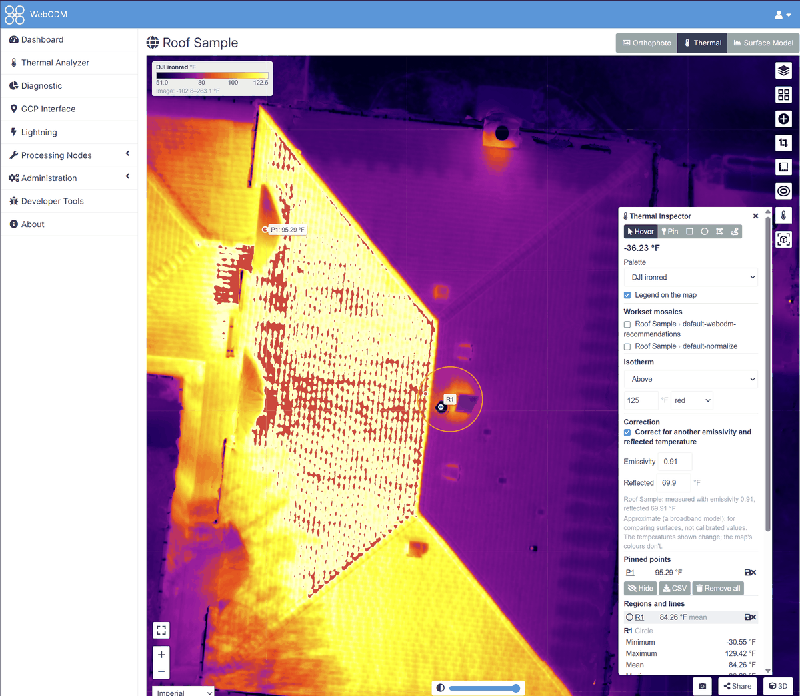

# DJI Thermal plugin for WebODM

[](docs/images/splash-source.png)

Process DJI radiometric thermal photos (R-JPEG) in WebODM and get temperature maps. The plugin gives two ways in:

- **DJI Thermal Task**, a button beside WebODM's "Select Images and GCP": the quick path. Each R-JPEG is converted into a
  temperature image (degrees Celsius) as it is uploaded, with measurement settings you can change, then WebODM
  processes them like any other task.
- **DJI Thermal Analyzer**, in WebODM's menu: for a flight you want to look at first. It checks the photos (what each one
  is, the problems found, the WebODM options to use), converts them with every dji-thermal-cli setting (several
  worksets side by side), places the frames into mosaics shown on a map, shows each frame on its own page (measured
  in its pixels, or measured again with other values), and makes a WebODM task from the workset you choose.
- **Thermal Inspector**, on WebODM's 2D map of a task with a thermal orthophoto: the temperature under the cursor,
  pinned points, the statistics of regions and lines drawn on it (with their surroundings and ΔT, and a line's
  profile), measurements saved for everyone who can view the project, an approximate correction for another
  emissivity and reflected temperature, isotherms, the map's palette, colour range and image adjustments (as the
  mosaic viewer's), and its legend. It also lays the Analyzer's workset mosaics on the map, to compare them with the
  project's own layers, and shows the frames that saw a point clicked.

Temperatures are computed with [dji-thermal-cli](https://pypi.org/project/dji-thermal-cli/), a pure-Python
implementation of DJI's Thermal SDK: no native library and no outside service. An administrator can have DJI's own
SDK compute them instead (see [DJI's own Thermal SDK](#djis-own-thermal-sdk)).

**[The documentation](docs/index.md)** has quickstarts with screenshots for each of these, guides (measurement
settings, palettes, installing, DJI's SDK), troubleshooting and the plugin's API.

## Installing

WebODM 3.3.2 or later, in Docker (Linux, Windows, macOS) or from its native Windows installer; checked on both.

- **From WebODM's plugin list**: Administration > Plugins, find DJI Thermal, install it.
- **From a release**: download `dji-thermal-X.Y.Z.zip` from this repository's
  [releases](https://github.com/WinuxNomacs/webodm-dji-thermal/releases) (its sha256 is given there), then
  Administration > Plugins > **Load Plugin (.zip)**. The zip holds the plugin's scripts built, so WebODM needs no
  webpack of its own (its native Windows install has none).

WebODM installs the plugin's requirements in the plugin's own folder: dji-thermal-cli, with numpy and Pillow at
WebODM's own versions. Restart WebODM if it asks you to.

The plugin calls no outside service: photos are converted, analyzed and mosaicked on your WebODM server. The mosaic
viewer's base layers are WebODM's own, loaded by your browser as on WebODM's other maps.

## The DJI Thermal Task

1. In a project on the dashboard, press **DJI Thermal Task** and pick the flight's photos, all of them if you like, and a
   GCP file if you have one. The plugin finds the thermal R-JPEGs among them by their content; the RGB photos taken
   with them are ignored and not uploaded. (To check the flight first or compare settings, the panel points to the
   DJI Thermal Analyzer.) The Workset Creation Settings ask the same values in the same order and words.
2. **Palette**, at the top: the DJI palette the task's thermal map (and the Thermal Inspector) opens in, starting on
   the one the photos were shot in, unless you've chosen a palette in the Analyzer's preferences; the task's images
   hold temperatures, so the map can show them in any palette later. A task made from a workset opens in the
   workset's palette, if it has one.
3. **Only frames looking down**, under it, ticked by default: as the WebODM plan, only the frames with a gimbal pitch
   at or below -80° (read from each photo) go into the task, with the count kept beside it ("42 of 217 frames");
   oblique frames mix viewing angles and sky into the map's temperatures. Untick it to keep every frame (for a 3D
   model). As is, the others are not converted (but kept in the dataset, if any); normalized, the workset leaves
   them out.
   **Normalize** and **Harmonize**, under it, off by default: as the workset settings of the same names (see
   below), one ambient and reflected temperature for every frame, and also each frame's drift removed. Ticked, every
   photo is uploaded first to the task's DJI Thermal Analyzer dataset (**Also keep the photos** is then ticked), a
   workset of it converts them in WebODM's worker, and its TIFFs go into the task, which then starts processing by
   itself. The message under the project, and the task's panel after the page is refreshed (above the panel's
   buttons), show how far the conversion is, then a green **Complete!** once the task has started; the page can be
   closed or refreshed once the upload is done; don't use WebODM's own **Start Processing** meanwhile, which would
   process the photos unconverted. The dataset is analyzed meanwhile, and a task whose options were left as the
   panel started them gets the WebODM plan's recommended options (its orthophoto resolution and GPS accuracy)
   before it starts. If putting the images in the task fails, the reason shows with the plugin's own
   **Start processing** to try again. **Also build the workset's mosaics**, off by default, builds
   the Analyzer's mosaics too; they can be built later from the workset's menu. The workset stays in the Analyzer.
4. **Measurement**: the values the temperatures are computed with. Each field shows the value the camera recorded
   and the range the camera accepts; left empty, every photo keeps its own recorded value.
   - **Temperature unit** of the values you enter: Celsius, Fahrenheit or Kelvin, by default WebODM's units (°F
     when imperial, else °C). The task's images are always in degrees Celsius.
   - **Emissivity**, **reflected temperature**, **ambient temperature** (the H20T and XT S do not use it, and the
     form says so) and **relative humidity**.
   - **Distance to the target**: by default each photo's laser rangefinder distance where it has a valid one
     (each photo of the M4T flight checked has one; DJI's sample images have none), else the distance the camera
     recorded (usually 5 m, whatever the flight height). Or the recorded distance, or one distance for all photos.
     With the rangefinder's distance, the temperatures differ slightly from DJI's own apps, which use the recorded
     one.
   - **Also keep the photos in a DJI Thermal Analyzer dataset**: the task is also a dataset, under its own name,
     that gets every photo picked (the RGB ones too) as they are uploaded, so they are sent once, and is analyzed
     once the task is made. The message under the project then links to it.
5. Below it, WebODM's own task panel: name, processing node, options and the photos on the map. The options start as
   the WebODM plan's, "(Custom)" with `radiometric-calibration` none (the images already hold temperatures). Images
   are not resized: the thermal frames keep their size. **Review**, then **Start Processing**.
6. Each photo is converted as it is uploaded, a few at a time. A photo that fails is left out with its reason;
   the task then processes the others. A GCP file, `geo.txt` and `image_groups.txt` go in with the photos' names
   changed to the converted images' (`DJI_0001_T.JPG` becomes `DJI_0001_T.tif`).

The task's name is suggested from the first photo's date. WebODM's own upload also looks the place up on
OpenStreetMap's Nominatim; the DJI Thermal Task does not, as the plugin calls no outside service.

The DJI Thermal Task keeps only the converted images, not the photos, unless you ticked **Also keep the photos in a
DJI Thermal Analyzer dataset**. To look at a task's photos in the Analyzer afterwards, press **Create thermal
dataset** in the task's expanded panel on the dashboard: the task becomes a dataset too, under its own name (no
other task is added), and the dataset opens, to add the flight's photos (**Add images**). The panel then has a
**Thermal dataset** button, back to it. Deleting the dataset leaves the task as it was, with its images and results,
and the Thermal Inspector's measurements saved on its map.

## The DJI Thermal Analyzer

**DJI Thermal Analyzer**, in WebODM's menu, lists the thermal datasets of every project you can view, with their
analysis and worksets at a glance (how many worksets, or how many of them are ready while some are not).

**Preferences** (the gear beside the DJI Thermal Analyzer's heading):

- **Temperature unit**: °C or °F, used throughout the Analyzer and the DJI Thermal Task whatever unit an image or
  workset holds. It is WebODM's own units setting (the Metric/Imperial selector on its map, kept in your browser):
  changing it in either place changes it in both, °F with imperial lengths.
- **Palette**, kept for your WebODM account: one of DJI's palettes or of WebODM's colour maps, and also the palette
  chosen on a mosaic's temperature tab. The mosaics' temperature tabs open in it (DJI's where the frames hold it).
  A DJI palette is also where new worksets start (unless your saved defaults have a palette of their own) and how
  the Files tab's thumbnails of thermal frames are drawn, from their temperatures, on the server (the first view of
  a large dataset takes a while; they are kept with the dataset). By default each image's own.

### A dataset and its analysis

**New Dataset**: a name, the project and the flight's photos (or their folder, whose subfolders are kept; you can
also drop them on the page). Only JPEGs are uploaded; the RGB photos taken with the thermal ones are listed, not
analyzed. The photos are then analyzed with dji-thermal-cli's check, in WebODM's worker, with its progress and a
Cancel button.

Under the dataset's name, its project and, when it is kept in a WebODM task with images (a DJI Thermal Task's, or one
sent a workset), that task's name, linking to it on the dashboard. The dataset's page opens with a summary, a row per camera (and one for all of them when there are several): its
frames and how many have GPS, the temperatures on the dataset's scale, when they were taken and over how long, the
height and the size. A camera's row opens its frames on the Files tab, and each figure opens them sorted by it
(hottest or highest first, in capture order; or only those without GPS). Under it, once analyzed, the steps from
photos to temperatures on a map, each done (✓) or a link to where it is done: check the problems, create a workset
(starting from the WebODM plan's settings), create a task from it, measure on the map once the task is processed.
Then:

- **Files**: every file with its capture time, height, gimbal pitch, temperatures, distance (recorded and the
  rangefinder's) and emissivity (the problems that name it in its detail pane); filtered by name, by kind or to those with
  problems, sorted by any column, with thumbnails if you like (in your preferred DJI palette, if you chose one).
  Click a file to open a detail pane beside the table: its picture (a thermal frame drawn from its temperatures in
  your preferred DJI palette, else in the one it was shot in) and everything the analysis read from it (camera, position, gimbal, temperatures, measurement
  parameters, warnings), with **Download** (the file as uploaded) and, for a thermal frame once a workset has converted,
  **Open frame** (the frame page, below; a thermal frame's name in the table opens it too). Click the picture to view it over the page: a
  thermal frame in the same palette, a photo as uploaded at its own size, fitted to the window, with zoom (the
  buttons, the mouse wheel where it points, a double click), **Fit** and **1:1**, dragging to pan, the previous and
  next images in the table's order (also ← and →), Download, and × or Esc to close (Ctrl/Cmd-click opens the
  picture in a new tab instead). In the table, Ctrl/Cmd-click adds or removes a file and Shift-click selects a range;
  with several selected, the pane counts them and downloads them as a zip. Clicking the only selected file, its ×
  or Esc unselects. **Hover for Detail** makes the pane follow the file under the mouse while none is selected.
  **Remove from dataset**, at the bottom of the pane, deletes the file (or those selected) once confirmed, for those
  who can change the project, while nothing runs: from the dataset, and from each workset that converted it (as
  Remove from workset does; the tasks made before keep their images). The analysis is kept, without the files, until
  **Analyze again**.
- **Problems**: what dji-thermal-cli found (errors, warnings, notes), each with what addresses it in the Workset
  Creation Settings' terms and the files it names (a file's value in its tooltip). Where one setting addresses it
  (Normalize, frames at or below −80°), a button sets it in the form on the Worksets tab.
- **WebODM plan**: how well the frames cover the ground, the task options to use (each with its section in
  WebODM's task options; to copy, or **Save as a WebODM preset** to pick in a new task), **Use these settings**
  for the workset that prepares the images (also as a dji-thermal-cli command, folded), and notes.
- **Worksets**: see below.

**Add images**, **Analyze again**, **Rename** and **Delete** are on the dataset's page, with a link icon beside its
name to copy a link to it; adding images marks the analysis out of date until it is run again.

### Worksets

The **Worksets** tab, the first on a dataset's page and the one it opens on, converts the images into a workset
with dji-thermal-cli's settings (**Create Workset**), in WebODM's worker, with progress (each harmonizing stage, then
the frames converted, not counting the RGB photos and oblique frames it skips) and Cancel. Each workset lists how many
frames it converted, left out as oblique, found not thermal and skipped. **Workset
Creation Settings:** opens and closes the settings, its chips showing what differs from the defaults either way; the **Outputs** section shows its own when
closed. A chip marked **≠ plan** differs from the WebODM plan's settings (hover for the plan's value).

- **Outputs**: temperature TIFFs in °C, °F or K, pseudo-colour PNGs, gray16, raw counts, DJI R-JPEGs and the others
  dji-thermal-cli writes, and their compression; the palette and colour range of the pictures.
- **Measurement**: each parameter, with the flight's recorded median beside it (left empty, each image keeps its
  own), and the unit of the files.
- **Corrections**: **Normalize** (one ambient and reflected temperature for every frame, the flight's medians) and
  **Harmonize** (also each frame's drift against its overlapping neighbours removed), a gimbal pitch limit for nadir frames only, gimbal overrides, temperatures above or below a threshold
  replaced, the location stripped.
- **Use the WebODM plan's settings** fills in what the plan recommends; **Copy settings to form**, in a workset's
  menu, fills in that workset's; **Save as my defaults** keeps your settings for new worksets (**Reset to defaults**
  goes back to dji-thermal-cli's).

Each workset is kept beside the others, with what it changed from the defaults, its **Files** (a table, closed at
first and remembered in your browser, of each image with its thumbnail, result, minimum and maximum temperature,
emissivity, reflected temperature and distance as the workset measured it, and why any was skipped, sortable by each either way, its headings in view as it scrolls),
its **Mosaics** below them once built (a table like the Files', closed at first and remembered too: each mosaic's
preview, frames, size, ground sample distance and temperature range, and beside it a pane with the preview at its
own size, its files to download, what dji-thermal-cli reports about it and **View mosaic**; Ctrl/Cmd-click selects
both, to download their files as one zip),
**Download all** (a zip), and **Rename** and **Delete** in its menu. Beside the table, a detail pane shows the image
under the mouse, or the one clicked: the frame at its own size, all it was measured with, and its downloads (the
workset's files, its temperatures as CSV or a float TIFF, and Open frame). Ctrl/Cmd-click or Shift-click selects
several, to download their files as one zip. **Remove from workset**, in the pane, takes the image (or those
selected) out of the workset for those who can change the project, once confirmed: their files and the measurements
saved on them are deleted, the workset counts them as removed, and new tasks and mosaics leave them out (the tasks
made before keep their images; mosaics built with them are marked out of date, with **Build again**). The figures are measured once, in WebODM's worker, after a workset
converts (an older workset's the first time its Files are opened). DJI's own
SDK measures them when an administrator has installed it.

### Mosaics

After converting (on by default in the settings, or **Build mosaics** from a workset's menu), dji-thermal-cli
places the frames side by side from their positions and angles, with no WebODM task needed: as converted, and
harmonized (the frames made to agree on temperature: one ambient and reflected temperature for every frame, and
each frame shifted to match its neighbours where they overlap, removing the camera's drift between its
self-calibrations). **View mosaics** shows them on a map
over WebODM's base layers:

- a tab for each mosaic (**Mosaic**, as converted, and **Harmonized**), **Source frame** (the mosaic with a black and
  white line where one frame meets the next) and **View angle** (the angle each pixel was seen at);
- the palette (the usual ones and the DJI palettes of the images; opening in your preferred one, if they hold it) and the
  range, changed live, with the colour scale (its ends marked with the range's own values)
  and **Auto** (the 2nd to 98th percentile);
- how the image is drawn (**Image**): **Brightness** and **Contrast** (which move and narrow the range), **Gamma**,
  **Sharpening** (an unsharp mask), **Linear** or **Equalized** (the colours spread over the temperatures the whole
  mosaic has most of; temperatures only) and **Reset**, drawn into the tiles and the frames' pictures, with the colour
  scale drawn to match; the temperatures stay as they are. The map follows the sliders, the range and the isotherm as
  they change, with no waiting: the browser colours each tile from its temperatures, which the server sends once (the
  frames' pictures are drawn again once a slider is let go of). The temperature tabs share them, and each visit starts
  without them;
- an **Isotherm** on the temperature tabs (above, below or between temperatures): its pixels keep the palette and the
  rest turns grey, on the map and in the frames' pictures;
- the temperature, frame, frame pixel and view angle under the cursor;
- a click on the map keeps those values at that point, marked, until **Follow the cursor** (or Esc), and opens a
  window over the map with the **frames that saw that point** (the mosaic's own first, the
  others in turn with the arrows), each drawn in the tab's palette and range (on View angle, the angle each of its
  pixels saw the ground at), with a crosshair on the point and its outline on the map, and **Open this frame** (the
  frame page, below, in a new tab); mosaics built before version 1.5.0 of dji-thermal-cli are built again to show them;
- what dji-thermal-cli reports (seams, misalignment, frame offsets, heights) and the mosaic files to download (also
  in the workset's zip);
- **Open on WebODM's map** (also in the workset's menu): WebODM's map of the project with this mosaic laid on it by
  the Thermal Inspector (below), to compare it with the project's tasks. Shown when WebODM has a map of the project
  (one of its tasks has finished with an orthophoto or an elevation model).

### The frame page

One frame of a workset at a time, as the workset measured it, opened from the frames window (**Open this frame**,
in the mosaic viewer and the Thermal Inspector) or from the Files tab (a thermal frame's name, or **Open frame** in
its detail pane: the frame page of the newest workset that converted):

- the dataset's thermal frames listed beside it in the order they were taken, the one shown marked, stepped through
  with ← and → (or the arrows at the top); once the mosaics are built, **All**, **In the mosaic** or **Oblique**
  (those the mosaics left out, and why); the frame and the list are in the page's address, to link to;
- the frame, zoomed and moved like a map, coloured in your browser from its temperatures with the mosaic viewer's
  palette, range, **Image** and **Isotherm** controls (Equalized from the frame's own histogram), following them as
  they move;
- the temperature of the pixel under the cursor;
- **Measure**: the Thermal Inspector's tools in the frame's pixels: a pin (a pixel's temperature), a line (a strip 1
  pixel either side of it, with its profile; hovering the profile marks its point), a rectangle, a circle or a
  polygon (the statistics, the surroundings, a ring 3 to 10 pixels wide, and ΔT, the isotherm's share and a
  histogram), labelled P1…, L1…, R1…, kept while the page is open and measured again when the isotherm or the
  parameters change;
- **Saved on this frame**: a measurement's Save (for those who can change the project) names it, with an optional
  comment, and keeps it with the workset, with the parameters it was measured with; everyone who can view the project
  sees them on the frame, dashed in green; those who can change it rename and delete them;
- **Measure again**: distance, humidity, emissivity, reflected and ambient temperature as the camera recorded them,
  as the frame was measured with them, and to change to; dji-thermal-cli measures the frame again with them, exactly
  as a workset converted with them would (not the Inspector's approximate correction), shown in a second pane beside
  the first, which moves with it, and the readout gives both temperatures and their difference. The changes stay as
  you step to other frames; **Clear** drops them, and **New workset with these** opens the Worksets tab with the
  form filled in with the workset's settings and these changes;
- the frame's size, range and mean, what normalizing or harmonizing did to it, and what dji-thermal-cli noted;
- **Download**: the frame as shown (PNG, at its own size), its temperatures as CSV (a row per row of pixels) or as a
  32-bit float TIFF (no location), as converted or with the parameters changed.

### A WebODM task from a workset

**Create task**, beside **View mosaics** on a converted workset that is in no task yet (in its menu once it is),
makes a WebODM task in the dataset's project from the
workset's temperature TIFFs in °C (the `temp_c` TIFF output), without uploading them again:

- It says what stops a task: a workset not finished converting, its location stripped (ODM needs it to place the frames), or
  fewer than 2 °C TIFFs. It also warns where the workset's settings are off the WebODM plan (not harmonized,
  oblique frames kept, emissivity or humidity), with **New workset with the plan's settings**.
- The plan's ODM options, the recommended ones ticked and the others to consider, each with its value and why; and
  the task's name.
- The task is made **without a processing node**: it waits in the project with "Set a processing node", which opens
  WebODM's own panel (the node and the options, as ticked). Processing starts once you save it there.

The workset lists the tasks made from it, each with its status and a link to it on the dashboard. On the
dashboard, such a task has a **Thermal dataset** button in its expanded panel, back to the dataset. A task keeps
its images when the workset or the dataset is deleted (the button then goes).

**Use for parent task**, in the workset's menu, sends the workset's °C TIFFs to the dataset's own task (see below)
instead of a new one, so one task is processed again and again as you try worksets:

- The TIFFs replace the images sent there before, and what the task processed from them (its orthophoto, models and
  other results) is removed; the dialog says what it replaces. It is refused while the task is processing.
- The task then waits for a processing node, as a new one does: the link in the message opens it on the dashboard,
  where **Set a processing node** sets its node and options. A task without options gets the plan's recommended ones;
  options you set there are kept the next time.
- The workset shows that the dataset's task holds its TIFFs, with the task's status.

### Where a dataset is kept

A dataset is kept in a task of its project, named "Thermal dataset: *name*": its photos and worksets are in that
task's folder, apart from the images WebODM processes, so the task holds no image until a workset is sent to it
(**Use for parent task**). It shows in the project's task list with "Set a processing node"; leave it unset until it
holds a workset's TIFFs. A dataset made for a DJI Thermal Task's task (**Create thermal dataset**, or **Also keep the
photos**) is kept in that task instead, under its name, with no other task. Its expanded panel on the dashboard has a
**Thermal dataset** button that opens the dataset in the DJI Thermal Analyzer. It is shared as the project is:

- viewing the project shows the dataset, its worksets and mosaics, and downloads them;
- changing the project allows adding images, analyzing, converting and making tasks;
- deleting the dataset needs the project's delete permission.

Its photos and worksets count toward the project owner's storage quota (no upload, conversion, mosaic or task once
the owner is over it); a task made from a workset counts its own images too. The dataset goes when its task or the
project is deleted. Deleting the dataset deletes its task too, unless a workset was sent to it or it is kept in a
DJI Thermal Task's task: the task is then kept as an ordinary WebODM task (named without "Thermal dataset:") with its
images and what it processed, and the Thermal Inspector's measurements saved on its map and its palette.
Temperatures are shown in the unit of your preferences (see above).

## The Thermal Inspector

On WebODM's 2D map of a task whose orthophoto holds temperatures (a single thermal band, as ODM makes from the
DJI Thermal Task's images or a workset's), or of a project with workset mosaics, a thermometer button opens the Thermal
Inspector:

- **Hover**: the temperature under the cursor, beside it and in the panel; outside the task's crop, outside the
  orthophoto and where it has no data it says so.
- **Pin**: a click pins the point with its temperature, labelled P1, P2…, shown on the map instead of WebODM's
  popup. The pins are listed in the panel (click one to go to it), can be hidden and shown together, removed, and
  downloaded as CSV (latitude, longitude, temperature). They are kept in your browser for the same tasks.
- **Regions and lines**: draw a rectangle or a circle (press and drag) or a polygon (click its corners; double-click
  or Enter finishes, Backspace removes the last corner, Esc cancels), labelled R1, R2…, or a line (click its points,
  finished the same way), labelled L1, L2…. The panel shows the statistics of the temperatures inside a region, or
  along a line (a strip 0.25 m either side of it): minimum, maximum, mean, median, standard deviation, 2nd and 98th
  percentiles, the number of pixels, the area or length, and a histogram; the hottest and coldest pixels are marked
  on the map. It also shows the **surroundings** (the mean of a ring around a region, from its outline out to its
  size, 1 to 3 m; of a band 1 m wide beside a line) and **ΔT**, the mean's difference with them; with the isotherm
  on, the share of the region's pixels in it. A line has its **profile** instead of the histogram: its temperatures
  every pixel along it, broken where there are none. Hovering the profile marks its
  point on the map (and on a workset mosaic names the frame it came from); a click there opens the frames that saw
  it. Pixels outside the task's crop or without data are left out; a region more than 4,096 pixels across is read at
  a reduced resolution, and the panel says so. Regions and lines are listed (click one's row for its statistics, or
  its name to go to it too), can be hidden, removed and downloaded as CSV (a row of statistics per region or line,
  with the hottest and coldest pixels' positions; a line's profile as its own CSV), and are kept in your browser for
  the same tasks.
- **Saved measurements**: a pin's, region's or line's Save (for those who can change the project) names it, with an
  optional comment, and keeps it with what it measures: the task, or the workset of a mosaic. It is measured again on
  the server as it is saved, with the isotherm's limits and the correction then on, and leaves your browser's lists.
  Everyone who can view the project sees the saved measurements of the layers on the map, dashed in green, with their
  values as saved, who saved them and when; those who can change it rename them, change their comment and delete
  them. The list downloads as CSV and GeoJSON (a line's profile as its own CSV).
- **Manual Corrections**: its tick box, beside the heading, opens the fields that correct the temperatures shown for
  another emissivity and reflected temperature than the photos were measured with, from what each layer records: an orthophoto's TIFFs (the values dji-thermal-cli wrote
  in them), a workset mosaic's settings or its frames. It is approximate (a broadband model, the air's transmission
  taken as 1), for comparing surfaces, not calibrated values. The readout, pins, regions, lines, the legend's marks
  and the isotherm's limits change, and the colour scale keeps the temperatures it shows, so the map's colours change
  with the correction (Auto stretches the scale over the corrected layer again). A layer that doesn't record its values (an orthophoto
  not made from the plugin's TIFFs) isn't corrected, and the panel says so. Kept in your browser for the same tasks;
  unticking it forgets the values and closes the fields.
- **Palette**: the thermal layer's palette, from the same list as the Analyzer's: DJI's palettes (drawn by the
  plugin) and WebODM's colour maps. It is your palette everywhere: the
  Analyzer's preference, saved when you choose one here or in WebODM's own layer panel, and the one the map opens
  in. WebODM's layer panel lists only its own colour maps; one it has that the Analyzer doesn't is drawn but not
  saved.
- **Colour scale**: under Palette, the topmost thermal layer's palette over its range, the range in your unit (typed,
  or **Auto**: its 2nd to 98th percentile) and the layer's own coldest and hottest temperatures. It is the range
  WebODM's layer panel sets, kept in step both ways (WebODM's panel shows a range set in the Inspector once the page
  is loaded again).
- **Image**: the mosaic viewer's controls for how the topmost thermal layer is drawn: Brightness and Contrast (moving
  and narrowing the range from Auto's), Gamma, Linear or Equalized (from the whole layer's histogram) and Sharpening,
  and Reset. The map follows them as they move, with the colour scale, the range and the isotherm: the thermal layers
  (the task's orthophoto, in any palette, and the mosaics laid on the map) are coloured in your browser from their
  temperatures, which the plugin sends once per tile, so nothing waits on the server (the orthophoto's histogram, for
  Equalized, is kept in the task's folder). WebODM's layer keeps its opacity, swipe and layer panel. The frames window
  draws its pictures alike, once a slider is let go of. Each thermal layer keeps its own range and adjustments, for
  this visit only.
- **Legend**: a colour bar of the thermal layer's palette over its range (shared out as the Image section draws it),
  in your unit, at the map's top left: its ends say the range's lowest and highest temperatures, with round values
  between. When the image's own coldest or hottest temperature lies outside that range (narrowed in the colour scale
  or WebODM's layer panel), a line under the bar gives them. It follows the palette and range, and "Legend on the
  map" hides it. With several thermal tasks on the map, it is the topmost one's.
- **The panel's top stays in view**: its heading, the mode buttons, the temperature under the cursor, Palette and
  the colour scale stay at the top while the sections below scroll under them.
- **Moving them**: drag the panel by its heading, or the legend by any part, to move it out of the way; both stay
  inside the map, and the frames window moves with the panel. Closing the panel, hiding the legend or reloading the
  page puts them back in their places.
- **Isotherm**: paints the temperatures above, below or between limits (typed in your unit) in a colour of six,
  over each thermal layer, hidden with it, within the task's crop; the legend marks the part painted. Kept in your
  browser for the same tasks; Off removes it.
- **Mosaic Overlays**: the mosaics of the Analyzer's worksets in the project's datasets (for those who can view the
  project; shown only when one has built mosaics), each with a tickbox that lays it on the map above WebODM's layers: **Mosaic**, **Harmonized** or **Source
  frame**, in your palette over its own 2nd to 98th percentile, with its opacity, **Swipe** (WebODM's own divider:
  the mosaic on the right, WebODM's layers on the left) and zoom to it. Hover, pins, regions, the isotherm and the
  legend read the topmost thermal layer, a mosaic or an orthophoto. They are the plugin's layers, not entries of
  WebODM's layer panel (a plugin can't add those), and are laid again on each visit; the workset's **Open on
  WebODM's map** opens the project's map with its mosaic laid. Not on WebODM's public maps.
- **Source frames**: a click in Hover (or a pin dropped, or a pin's name clicked in the panel) on a workset mosaic, or
  on the orthophoto of a task processed from a workset whose mosaics are built, opens the window of the frames that
  saw that point beside the panel, as in the mosaic viewer: one at a time with a crosshair on the point, its outline
  on the map, drawn in the layer's palette and range. On a mosaic, its own frame comes first; on an orthophoto, the
  one that saw the point closest to straight down, placed with the workset's camera models (from the frames' GPS and
  gimbal, not ODM's refined cameras, so the point can be a little off), and **Open this frame**: the frame page, in a
  new tab. Elsewhere a click in Hover is still WebODM's (its popup).

Temperatures are read from the orthophoto or mosaic on the server (the plugin's own API, for those who can view the
task or project) and shown in WebODM's units (°F when imperial), the same setting as the Analyzer's.

## The converted images

Each thermal R-JPEG becomes a single-band 32-bit float TIFF of its temperatures in degrees Celsius, measured with
the Measurement settings above. It keeps all of the photo's EXIF and DJI XMP metadata, with what ODM uses (GPS,
altitudes, capture time, camera and gimbal angles, RTK accuracy), and is marked as a thermal band (`Camera:BandName` =
`LWIR`), so ODM processes it as thermal. Its XMP also records how it was measured, as dji-thermal-cli's own
outputs do (namespace `urn:dji-thermal-cli:xmp:1.0`): `Distance`, `DistanceSource` (`rangefinder`, `embedded` or
`option`), `Emissivity`, `Humidity`, `ReflectedTemperatureC`, `AmbientTemperatureC` and `Software`. The photos
themselves are not kept.

## DJI's own Thermal SDK

By default the temperatures come from dji-thermal-cli's built-in port of DJI's Thermal SDK v1.8, which gives the
same results as DJI's own SDK on DJI's sample images. If you prefer DJI's own library, it can compute every
photo's temperatures instead. **It is usually only needed for development purposes: it reduces the performance of
the DJI Thermal Analyzer.** The **DJI Thermal** page, under **Administration** in WebODM's menu (for
superusers only), shows which of the two is in use and changes it:

- **Upload** the [DJI Thermal SDK](https://www.dji.com/downloads/softwares/dji-thermal-sdk) zip as DJI's site gives
  it (version 1.8; another version is refused). The plugin keeps only the libraries for the server (Linux x64 in
  WebODM's Docker install, Windows x64 in its native Windows install), DJI's `License.txt` and one sample image per
  camera, and checks the SDK measures those samples before using it. DJI's license terms apply to the SDK; the
  plugin does not include it. DJI builds the SDK for x64 and x86 processors only: on an ARM server, such as WebODM
  in Docker on an Apple Silicon Mac, the page says so and the built-in port is used.
- **Update** replaces it with a newer zip, **Check** measures the samples again, **Remove** goes back to the
  built-in port.
- **At deployment**, `DJI_THERMAL_SDK_DIR` on WebODM's webapp container can name a folder for the SDK (an
  unpacked SDK, or an empty folder the page's upload then fills; WebODM must be able to write to it for Update). It
  wins over an upload. If it names a folder without the SDK, photos fail with that reason rather than being
  measured by another SDK.

DJI's library runs in a process of its own, never in WebODM's: if it crashes on a photo, that photo fails with
the reason and the others go on. A converted image records which SDK measured it in its XMP `Software` tag.

## Cameras

Every camera dji-thermal-cli decodes: H20N, H20T, H30T, M2EA, M30T, M3T, M3TD, M4T and XT S. The M4T has been
checked on a real flight; the others on DJI's Thermal SDK sample images only.

## Developing

`CLAUDE.md` describes the dev environment (WebODM in Docker on port 8002, `dev/webodm.sh`) and the checks. `dev/screenshots.js`
takes the documentation's screenshots from it.

The plugin's parts: `converter.py` (R-JPEG to TIFF), `api.py` (its API, under `/api/plugins/dji-thermal/`: `describe` a
photo's camera, recorded values and ranges; `projects/<id>/tasks/<id>/convert` one photo into a partial task, with
WebODM's project permission), `sdk.py` with `page.py` and `templates/sdk.html` (DJI's own SDK and the DJI Thermal page,
`/plugins/dji-thermal/sdk/`), the DJI Thermal Analyzer (`datasets.py`: the holder tasks and their records; `analysis.py`:
the analysis job, run by WebODM's worker; `conversions.py`: the conversions, their settings and job, and each user's
defaults; `mosaics.py`: a conversion's mosaics, their job, and the viewer's tiles and values with WebODM's rio-tiler;
`conversion_tasks.py`: a WebODM task from a conversion, or the dataset's own task given its TIFFs; `analyzer_api.py`:
its API under `/api/plugins/dji-thermal/datasets`, with a conversion's `task` and `parent`; `analyzer_pages.py` with
`templates/datasets.html`, `dataset.html` and `viewer.html`: its pages, `/plugins/dji-thermal/`,
`/plugins/dji-thermal/dataset/<id>` and its conversions' mosaics, `.../dataset/<id>/conversion/<id>`), and `public/`
(`main.js`, which adds the button and the DJI Thermal page's link under Administration; `analyzer_core.js`,
`datasets.js`, `dataset.js`, `conversions.js`, `viewer.js` and `analyzer.css`, the Analyzer's pages, plain scripts; and
`thermal/`, the button and panel (JSX) and WebODM's own Leaflet for the viewer (`Leaflet.js`), built by WebODM's webpack
when the plugin is installed).

The tests never use images or DJI's files from this repository: none is committed or published. Those that need
real R-JPEGs or DJI's SDK read them from your machine, set in an untracked `.env` file at the repo root, and are
skipped when these are not set:

```
DT_SAMPLES_DIR=/path/to/dji_thermal_sdk/dataset   # DJI's Thermal SDK sample images, one folder per camera
DT_FLIGHT_DIR=/path/to/a/flight                   # a real flight's photos, thermal and RGB, in any subfolders
DT_SDK_ZIP=/path/to/dji_thermal_sdk_v1.8.zip      # DJI's Thermal SDK zip as DJI's site gives it
```

`dev/webodm.sh up` mounts them read-only in the dev containers.

## License

[AGPL-3.0](LICENSE).
