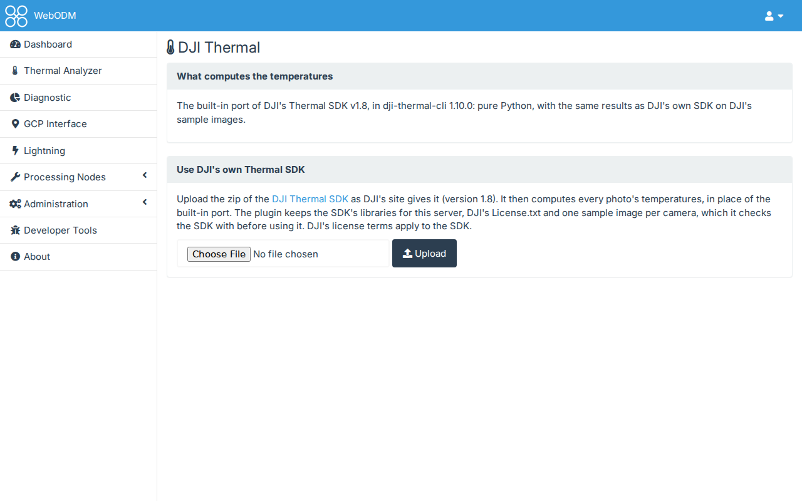

# DJI's own Thermal SDK

By default, temperatures come from dji-thermal-cli's built-in port of DJI's Thermal SDK v1.8. It gives the same
results as DJI's own SDK on DJI's sample images. If you prefer DJI's own library, an administrator can have it
compute every photo's temperatures instead.

## The DJI Thermal page

**Administration > DJI Thermal**, in WebODM's menu (superusers only), shows which of the two is in use.

- **Upload**: the [DJI Thermal SDK](https://www.dji.com/downloads/softwares/dji-thermal-sdk) zip as DJI's site gives
  it. It must be version 1.8; another version is refused. The plugin keeps only the libraries for your server
  (Linux x64 in WebODM's Docker install, Windows x64 in its native Windows install), DJI's `License.txt` and one
  sample image per camera. It checks that the SDK measures those samples before using it.
- **Update** replaces it with a newer zip, **Check** measures the samples again, and **Remove** goes back to the
  built-in port.

DJI's license terms apply to the SDK. The plugin doesn't include it.

DJI builds the SDK for x64 and x86 processors only. On an ARM server, such as WebODM in Docker on an Apple Silicon
Mac, the page says so and the built-in port is used.

## Setting it at deployment

`DJI_THERMAL_SDK_DIR`, on WebODM's webapp container, can name a folder for the SDK: either an unpacked SDK, or an
empty folder that the page's upload then fills (WebODM must be able to write to it for **Update**). It wins over an
upload. If it names a folder without the SDK, photos fail with that reason rather than being measured by the
built-in port.

## How it runs

DJI's library runs in a process of its own, never in WebODM's. If it crashes on a photo, that photo fails with the
reason and the others carry on. Each converted image records which SDK measured it, in its XMP `Software` tag.
