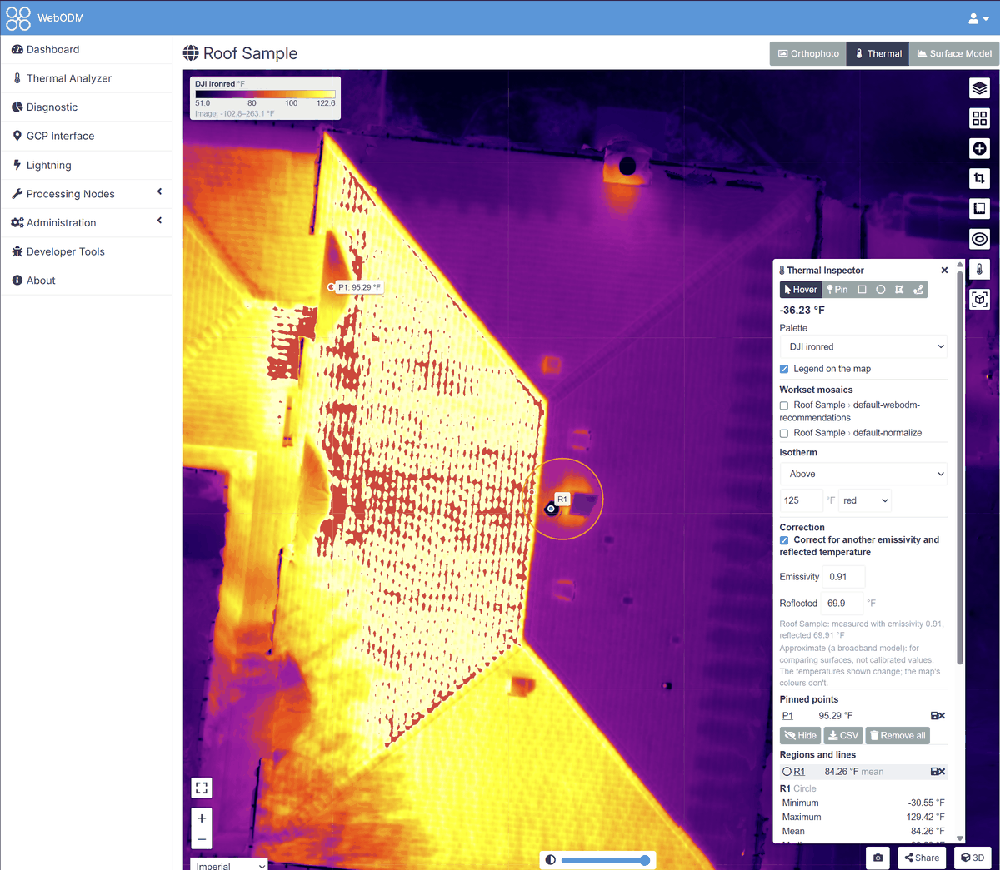

# DJI Thermal plugin for WebODM

The DJI Thermal plugin turns the radiometric thermal photos of a DJI drone (R-JPEGs) into temperature maps in
[WebODM](https://github.com/WebODM/WebODM). It adds three things to WebODM:

- **DJI Thermal Task**, a button on each project of the dashboard. It's the quick way: the photos are converted into
  temperature images as they upload, then WebODM processes them like any other task.
- **DJI Thermal Analyzer**, in WebODM's menu, for a flight you want to look at first. It checks the photos, converts
  them with the settings you choose (several worksets side by side), shows quick mosaics on a map and each frame on
  its own page, and makes a WebODM task from the workset you pick.
- **Thermal Inspector**, on WebODM's map of a processed thermal task. It shows the temperature under the cursor,
  pinned points, the statistics of regions and lines (surroundings, ΔT, a line's profile), measurements saved for
  the project, a correction for another emissivity, isotherms and a legend, lays the Analyzer's mosaics on the map to
  compare them with the project's own layers, and shows the frames that saw a point.

Temperatures are computed on your WebODM server by [dji-thermal-cli](https://pypi.org/project/dji-thermal-cli/),
a pure-Python version of DJI's Thermal SDK. The plugin calls no outside service.

## Quickstarts

Each one walks through a task from start to finish.

1. [A thermal map with DJI Thermal Task](quickstart-thermal-task.md): from the flight's photos to an orthophoto
   of temperatures.
2. [Checking a flight in the DJI Thermal Analyzer](quickstart-analyzer.md): upload the photos, read the problems
   found and the settings WebODM should use.
3. [Worksets, mosaics and a task](quickstart-worksets.md): convert the photos, look at the mosaics and at each frame
   (measured, or measured again with other values), and make a WebODM task from them.
4. [Measuring on the map](quickstart-inspector.md): temperatures, points, regions and lines on the processed map,
   saved for the project and corrected for another emissivity.

## Guides

- [Installing](installing.md): WebODM in Docker (Linux, Windows, macOS) or WebODM's native Windows installer.
- [Measurement settings](measurement.md): emissivity, distance, reflected and ambient temperature, humidity, and
  what each one changes.
- [Palettes and units](palettes.md): how temperatures are coloured and in which unit they're shown.
- [DJI's own Thermal SDK](dji-sdk.md): having DJI's library compute the temperatures instead.

## Reference

- [The converted images](converted-images.md): what a temperature TIFF holds.
- [Troubleshooting](troubleshooting.md): messages you may see and what to do about them.
- [The plugin's API](api.md): the HTTP endpoints the pages use.

## Cameras

Every camera dji-thermal-cli decodes: H20N, H20T, H30T, M2EA, M30T, M3T, M3TD, M4T and XT S. The M4T has been
checked on a real flight; the others on DJI's Thermal SDK sample images.

The plugin's source, releases and issues are on
[GitHub](https://github.com/WinuxNomacs/webodm-dji-thermal). It's licensed under the
[AGPL-3.0](https://github.com/WinuxNomacs/webodm-dji-thermal/blob/main/LICENSE).
