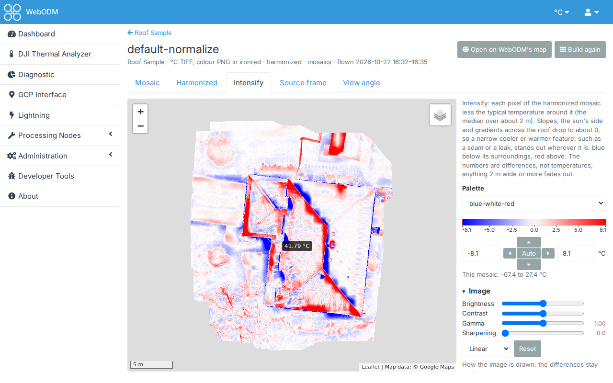

# Measurement settings

A thermal camera measures the infrared radiation reaching it, not temperature. To turn that into the temperature of
the surface, dji-thermal-cli (like DJI's own software) needs a few values about the surface and the air between it
and the camera. These are the measurement settings. The DJI Thermal Task panel and the Workset Creation Settings ask for
the same values, in the same order.

**Left empty, each photo keeps the value its camera recorded.** The pilot sets these in DJI's flight app, and the
camera writes them into each photo. Each field shows the recorded value (in the DJI Thermal Analyzer, the flight's
median) and the range the camera accepts.

## Emissivity

How well the surface gives off infrared radiation, from 0 to 1. This one matters most.

- Most natural and building surfaces are high: vegetation, soil, water, concrete, brick, asphalt, roofing felt,
  painted surfaces and skin are about 0.90 to 0.98.
- Bare or polished metal is low (often below 0.3). Its readings mostly show what it reflects, and are unreliable
  whatever value you set.

Set the emissivity of the surface you care about. With one value for the whole flight, surfaces of other materials
will be off. To compare surfaces of other materials afterwards, the Thermal Inspector's
[correction](quickstart-inspector.md#8-correcting-for-another-emissivity) shows approximately what they'd measure
with another emissivity and reflected temperature.

## Reflected temperature

Every surface reflects some of its surroundings' radiation, and more so the lower its emissivity. This is the
temperature of what the surface reflects. For surfaces facing up, that's mostly the sky, which can be far colder
than the air on a clear day. With a high emissivity it changes little.

## Ambient temperature and relative humidity

The air between the camera and the surface absorbs some of the surface's radiation and adds its own. DJI's SDK
corrects for it from the air temperature, the humidity and the distance (below). The H20T and the XT S don't use the
ambient temperature, and the form says so.

**What the camera records isn't the air's temperature.** On the M4T flight checked, every photo records 5 m,
50 % humidity, and the same value for the ambient and the reflected temperature. That value drifts during the
flight (here 26.6 to 27.8 °C) in steps of 1/16 °C. It's the camera's own estimate, not a weather reading.

## Distance to the target

How far the surface is from the camera, for the same air correction.

**The intent of this setting is to match the drone's thermal camera, as DJI designed it.** The distance
may be a setting of the thermal camera's own, apart from the laser rangefinder and the flight height (on the M4T,
in DJI Pilot 2's temperature measurement settings), so verify it on your drone before a flight. The camera writes
the setting into each photo, and DJI's own tools measure each photo with it. DJI's Thermal Analysis Tool guide says "The
camera's default calibration distance is generally fixed during production. This is the distance at which
temperature measurements are the most accurate." So the plugin measures with it too, by default.

The setting doesn't change what the camera captures: the photo's raw data is the same whatever it is, and the
distance is applied afterwards, when temperatures are computed (checked on the iirp photos, the M4T's on older
firmware: their raw values are the camera's uncorrected reading, and DJI corrects on top). Three choices:

- **As recorded** (the default): the distance the drone's thermal camera was set to for the flight, as recorded in
  each photo. It's usually 5 m whatever the flight height. The temperatures match DJI's own tools.
- **Laser rangefinder, else as recorded (Experimental)**: each photo's laser rangefinder distance where it has a
  valid one, else the distance its camera recorded, given to DJI's automatic correction for the air. Of the photos
  checked, every M4T photo has one; DJI's sample images have none. The correction grows quickly with distance: at
  flight heights it can make temperatures differ greatly from the photo as its camera recorded them (below).
- **Set for all photos**: one distance you type.

[How DJI uses distance](distance.md) explains each distance a photo holds (the camera's, the rangefinder's, the
drone's altitude), what DJI's correction does with it, and why Laser rangefinder is experimental.

## Distance, ambient temperature and humidity together

The correction grows with the distance. Over a few metres it's small, whatever the air temperature. Over tens of
metres it depends mostly on the ambient temperature:

- If the ambient temperature is warmer than the real air, the SDK removes too much of the air's heat, and
  everything reads too cold. Surfaces cooler than the air drop the most.
- If it's cooler than the real air, everything reads too warm.

Measured on one frame of the M4T flight, with the recorded ambient temperature (27.6 °C):

| Distance | Mean | Coolest pixel |
|---|---|---|
| 5 m (as recorded) | 22.8 °C | 13.2 °C |
| 21 m (the rangefinder's) | 21.8 °C | 10.0 °C |
| 100 m | 18.8 °C | −3.5 °C |
| 200 m | 17.8 °C | −3.5 °C |

At 100 m, an ambient temperature of 20 °C instead of 27.6 °C turns that frame's mean shift from −4.0 °C into
+4.6 °C. The humidity matters far less: 20 % or 80 % moves the mean by under 0.3 °C.

At long distances DJI's correction pivots on the ambient temperature: a surface at that temperature doesn't move,
and every other is pushed away from it, roughly twice as far at 120 m as at 5 m on the M4T photos checked. So with
a scene spanning several degrees (ice at 0 °C and a sunlit object at 18 °C, say), no single ambient temperature puts
them all right: setting it to one surface's temperature leaves that one right and moves the other. DJI's correction
treats 120 m of air as letting through about half the radiation that 5 m does; whether the air absorbed that much on
the day can only be checked against a known temperature.

So:

- **Keep As recorded** unless you have a reason not to: it measures as the drone's thermal camera was set, as DJI
  intends, and the temperatures match DJI's tools. Type the ambient temperature and humidity measured at the time of
  the flight if you have them; the ambient temperature matters even at 5 m.
- **To use a longer distance** (the rangefinder's, or one you type), check the result against something of known
  temperature in the scene (melting ice is 0 °C; water, or an object you measured), at several distances with the
  frame page's **Measure again**.

To see what a value changes before converting a whole flight, use the frame page's **Measure again** (below).

This is DJI's own correction, the one its apps and other tools built on DJI's SDK use. Older versions of the SDK, and
some cameras (the H20T), accept distances only from 1 to 25 m. With the SDK the plugin uses, the M4T accepts 1 to
300 m, and each field shows its camera's range.

## Temperature unit

In the DJI Thermal Task panel, **Temperature unit** is the unit of the values you type: Celsius, Fahrenheit or
Kelvin. The task's images are always in degrees Celsius. The Workset Creation Settings take temperatures in your
unit, °C or °F (see [Palettes and units](palettes.md)). Their **Unit of the files**, in the Measurement section, is
the unit of the workset's mosaics and of the frame page's temperature downloads; the frames' temperature TIFFs are in
the units ticked in Outputs.

## Normalize and harmonize

The camera recalibrates itself during a flight, and the recorded ambient and reflected temperatures can change from
photo to photo. So overlapping frames of the same ground can read a degree or two apart, and a map made from them
shows seams. The Workset Creation Settings' Frames section has two settings for it, and the DJI Thermal Task panel
has the same two (the task's photos are then converted by a workset of its dataset):

- **Normalize** measures every frame with one ambient and reflected temperature: the flight's medians of the values
  the frames recorded (a value typed in Measurement is used instead). It's quick, and removes the jumps where the
  recorded values change.
- **Harmonize** also removes each frame's drift against the frames overlapping it, found by comparing their
  overlaps as a mosaic does. It takes longer, and frames that can't be placed (oblique, or without a position) keep
  their drift. Ticking it ticks Normalize. The WebODM plan recommends it for processing into a map.

Neither changes how much warmer or cooler a spot is than the ground beside it in the same frame: Normalize changes
the two values every pixel of a frame is measured with, and Harmonize shifts a whole frame by one number (the frame's
offset, kept in its results). They change a frame's absolute temperatures, by up to its offset, to make the frames
agree. So they suit comparing areas across a flight; to check a spot against a fixed limit (such as "above 80 °C"),
read it in a workset with neither, where each frame is measured as it recorded.

## Finding small differences: Intensify

A small difference (a seam 2 to 3 °C cooler than the roof around it, from air getting in) can be hard to see on a
roof whose slopes and sides are at different temperatures: no single colour range suits all of it. The mosaic
viewer's **Intensify** tab shows the harmonized mosaic with each pixel's difference from its surroundings, the median
of the pixels around it over about 2 m. What is wider than that (a slope, the sun's side, a gradient) drops to about
0; what is narrower keeps its difference: the seam reads -2 to -3 wherever it is on the roof. In blue-white-red over
a range centred on 0, cooler features show blue and warmer ones red, and an isotherm below -1.5 picks out every spot
1.5 degrees cooler than its surroundings.

It is a view: the temperatures, the TIFFs and the downloads stay as they are, and the readout gives both the
difference and the harmonized temperature. Something as wide as the neighbourhood or wider (a whole wet patch several
metres across) fades out, and the edge between two surfaces at different temperatures shows a band of each colour
along it. Mosaics built before the plugin had it show it once built again.

To compare two spots exactly, use the **ΔT** tool in the Thermal Inspector
([Measuring on the map](quickstart-inspector.md)) or on the frame page: each spot is read as its own pixel.

## Trying other values on one frame

The frame page's **Measure again** measures one frame with other values for the distance, humidity, emissivity,
reflected and ambient temperature, exactly as a workset with them would, and shows it beside the frame as converted
(see [One frame at a time](quickstart-worksets.md#one-frame-at-a-time)). It's the quick way to see what a value
changes before converting the whole flight with it: **New workset with these** then fills in the Workset Creation
Settings. The Thermal Inspector's correction, on the map, is an approximation instead, for comparing surfaces.

A workset made before Harmonize existed with Normalize ticked did both, and shows both ticked. The mosaic viewer's
**Harmonized** mosaic is always harmonized, whatever the workset's settings.
