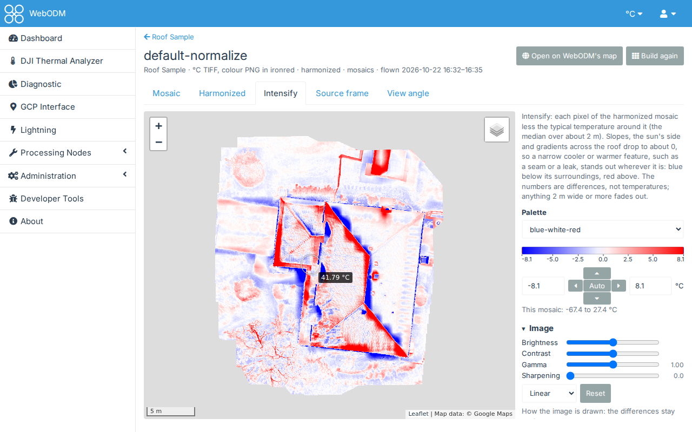

# Measurement settings

A thermal camera measures the infrared radiation reaching it, not temperature. To turn that into the temperature of
the surface, dji-thermal-cli (like DJI's own software) needs a few values about the surface and the air between it
and the camera. These are the measurement settings. The DJI Thermal Task panel and the Workset Creation Settings ask for
the same values, in the same order.

**Left empty, each photo keeps the value its camera recorded.** The pilot sets these in DJI's flight app, and the
camera writes them into each photo. Each field shows the recorded value (in the DJI Thermal Analyzer, the flight's
median) and the range the camera accepts.

## Emissivity

How well the surface gives off infrared radiation, from 0 to 1. This one matters most.

- Most natural and building surfaces are high: vegetation, soil, water, concrete, brick, asphalt, roofing felt,
  painted surfaces and skin are about 0.90 to 0.98.
- Bare or polished metal is low (often below 0.3). Its readings mostly show what it reflects, and are unreliable
  whatever value you set.

Set the emissivity of the surface you care about. With one value for the whole flight, surfaces of other materials
will be off. To compare surfaces of other materials afterwards, the Thermal Inspector's
[correction](quickstart-inspector.md#7-correcting-for-another-emissivity) shows approximately what they'd measure
with another emissivity and reflected temperature.

## Reflected temperature

Every surface reflects some of its surroundings' radiation, and more so the lower its emissivity. This is the
temperature of what the surface reflects. For surfaces facing up, that's mostly the sky, which can be far colder
than the air on a clear day. With a high emissivity it changes little.

## Ambient temperature and relative humidity

The air between the camera and the surface absorbs some radiation. The air temperature and humidity, with the
distance, tell how much. The effect is small at drone distances. The H20T and the XT S don't use the ambient
temperature, and the form says so.

## Distance to the target

How far the surface is from the camera, for the same air correction. Three choices:

- **Laser rangefinder, else as recorded** (the default): each photo's laser rangefinder distance where it has a
  valid one, else the distance its camera recorded. Of the photos checked, every M4T photo has one; DJI's sample
  images have none.
- **As recorded**: the distance the camera recorded. It's usually a fixed 5 m whatever the flight height. DJI's own
  apps use it, so choose this to match their temperatures exactly.
- **Set for all photos**: one distance you type.

With the rangefinder's distance, temperatures differ slightly from DJI's apps, but they're nearer the truth when
the camera recorded 5 m and the drone flew at 20 m.

## Temperature unit

In the DJI Thermal Task panel, **Temperature unit** is the unit of the values you type: Celsius, Fahrenheit or
Kelvin. The task's images are always in degrees Celsius. The Workset Creation Settings take temperatures in your
unit, °C or °F (see [Palettes and units](palettes.md)). Their **Unit of the files**, in the Measurement section, is
the unit of the workset's mosaics and of the frame page's temperature downloads; the frames' temperature TIFFs are in
the units ticked in Outputs.

## Normalize and harmonize

The camera recalibrates itself during a flight, and the recorded ambient and reflected temperatures can change from
photo to photo. So overlapping frames of the same ground can read a degree or two apart, and a map made from them
shows seams. The Workset Creation Settings' Frames section has two settings for it, and the DJI Thermal Task panel
has the same two (the task's photos are then converted by a workset of its dataset):

- **Normalize** measures every frame with one ambient and reflected temperature: the flight's medians of the values
  the frames recorded (a value typed in Measurement is used instead). It's quick, and removes the jumps where the
  recorded values change.
- **Harmonize** also removes each frame's drift against the frames overlapping it, found by comparing their
  overlaps as a mosaic does. It takes longer, and frames that can't be placed (oblique, or without a position) keep
  their drift. Ticking it ticks Normalize. The WebODM plan recommends it for processing into a map.

Neither changes how much warmer or cooler a spot is than the ground beside it in the same frame: Normalize changes
the two values every pixel of a frame is measured with, and Harmonize shifts a whole frame by one number (the frame's
offset, kept in its results). They change a frame's absolute temperatures, by up to its offset, to make the frames
agree. So they suit comparing areas across a flight; to check a spot against a fixed limit (such as "above 80 °C"),
read it in a workset with neither, where each frame is measured as it recorded.

## Finding small differences: Intensify

A small difference (a seam 2 to 3 °C cooler than the roof around it, from air getting in) can be hard to see on a
roof whose slopes and sides are at different temperatures: no single colour range suits all of it. The mosaic
viewer's **Intensify** tab shows the harmonized mosaic with each pixel's difference from its surroundings, the median
of the pixels around it over about 2 m. What is wider than that (a slope, the sun's side, a gradient) drops to about
0; what is narrower keeps its difference: the seam reads -2 to -3 wherever it is on the roof. In blue-white-red over
a range centred on 0, cooler features show blue and warmer ones red, and an isotherm below -1.5 picks out every spot
1.5 degrees cooler than its surroundings.

It is a view: the temperatures, the TIFFs and the downloads stay as they are, and the readout gives the harmonized
temperature and its ΔT from surroundings (below). Something as wide as the neighbourhood or wider (a whole wet patch several
metres across) fades out, and the edge between two surfaces at different temperatures shows a band of each colour
along it. Mosaics built before the plugin had it show it once built again.

A difference like it is under the cursor wherever a temperature is: **ΔT from surroundings** in Pointer Info, on the
mosaic viewer's temperature tabs and Intensify, on the frame page and in the Thermal Inspector's Hover reading: the
point less the median of the pixels within a circle around it, drawn as a thin circle around the pointer. The
**Delta T From Surroundings** slider under Pointer Info sets its radius, from 0.25 to 10 m (1 m until you move it,
about Intensify's neighbourhood; then kept with your preferences, for every page): a small circle compares a spot
with what is right beside it, a large one with the whole roof face. The circle always holds the pixels beside the
point, however small. The frame page works out a frame pixel's ground size from the distance it was measured at and
the camera's focal length. It needs no Intensify mosaic, so it works on mosaics built before it too; on Intensify it
is worked out from the harmonized mosaic, so it follows the slider while the picture stays drawn over 2 m.

## Trying other values on one frame

The frame page's **Measure again** measures one frame with other values for the distance, humidity, emissivity,
reflected and ambient temperature, exactly as a workset with them would, and shows it beside the frame as converted
(see [One frame at a time](quickstart-worksets.md#one-frame-at-a-time)). It's the quick way to see what a value
changes before converting the whole flight with it: **New workset with these** then fills in the Workset Creation
Settings. The Thermal Inspector's correction, on the map, is an approximation instead, for comparing surfaces.

A workset made before Harmonize existed with Normalize ticked did both, and shows both ticked. The mosaic viewer's
**Harmonized** mosaic is always harmonized, whatever the workset's settings.
