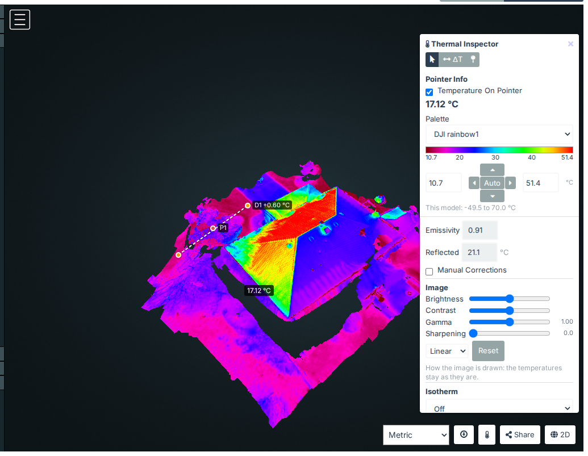
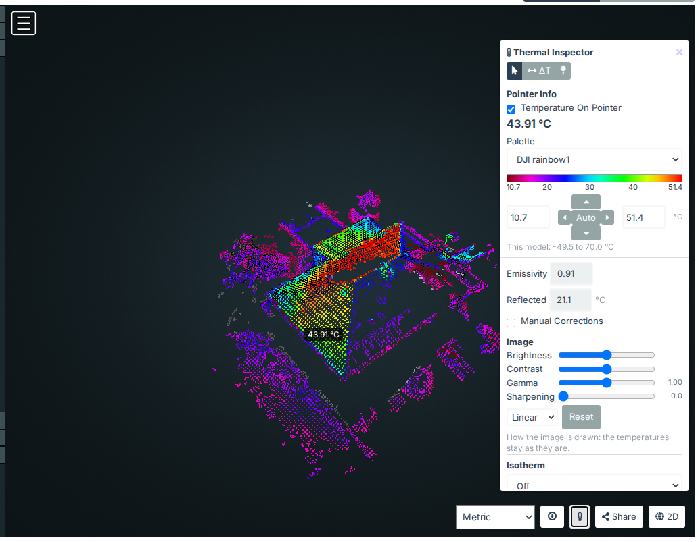

# Measuring on the 3D model

WebODM's 3D view of a thermal task shows its textured model and its point cloud. The plugin colours both in your
palette from their temperatures, and its 3D Thermal Inspector reads them: the temperature under the pointer, pins and
ΔTs. It works on a task made with [DJI Thermal Task](quickstart-thermal-task.md) or from a
[workset](quickstart-worksets.md), whose model ODM textured from the temperature TIFFs.

## 1. Open the 3D view

Open the task's 3D view from the dashboard (**3D Model**), or with **3D** on its map. The model opens in your
palette (the one the 2D map uses), or else in the palette chosen for the task in DJI Thermal Task. Its colours come
from the temperatures the model's textures hold, not from the grey ODM draws them in.

Press the thermometer button at the bottom right, beside **Share**, to open the 3D Thermal Inspector. The button is
only on tasks whose model holds temperatures: an RGB task's 3D view has none.

## 2. Read temperatures

The panel's buttons choose what a click on the model does:

- **Hover**: the temperature under the pointer, in the panel under **Pointer Info**, and beside the pointer (clear
  **Temperature On Pointer** to hide it; the choice is kept with your preferences). On a phone, tap the model to
  read a spot. Off the model, or where its texture holds no temperature, the panel says so.
- **ΔT**: click a first spot, then a second (D1, D2…). The panel gives each spot's temperature, **ΔT** (the second's
  minus the first's) and the distance between them, in metres along a straight line through the air. The view shows a
  dashed line between them. Esc forgets a first spot clicked by mistake.
- **Pin**: a click pins the point with its temperature (P1, P2…).

Pins and ΔTs are listed under **Measurements**, with Hide/Show, **CSV** (a row each: its position in the model's
coordinates, x, y and z in the task's projection, and its temperature, or the two spots and the ΔT) and Remove all.
They are kept in your browser for this task, apart from the 2D map's.

Dragging the view still turns and moves it: only a click (a press let go where it was pressed) measures.

## 3. Colours, scale and isotherm

The palette, colour scale, Image section and isotherm are the 2D Inspector's (see
[Colours, legend and isotherms](quickstart-inspector.md#3-colours-legend-and-isotherms)), over the model's
temperatures:

- **Palette**: your palette, saved when you choose one here, so the 2D map opens in it too.
- **Colour scale**: **Auto** is the model's 2nd to 98th percentile; **This model** gives its coldest and hottest
  temperatures.
- **Image**: Brightness, Contrast, Gamma, Linear or Banded, and Sharpening change how the model is drawn, never its
  temperatures.
- **Isotherm**: paints the temperatures above, below or between limits over the model and the point cloud. It's shared
  with the task's 2D map.
- **Legend**: at the view's bottom left; drag the panel by its heading, or the legend, to move them.
- **Manual Corrections**: correct the temperatures for another emissivity and reflected temperature, as on the map
  ([section 8](quickstart-inspector.md#8-correcting-for-another-emissivity)).

Closing the panel leaves the model in the palette.

## 4. The point cloud

Choose the point cloud in WebODM's 3D view (its **Point Cloud** and **Textured Model** buttons), and the plugin colours
it too.

ODM colours a thermal point cloud grey, each photo stretched over its own range, so its colours can't be read back as
temperatures. Instead, each point takes the temperature of the model's nearest surface, if that surface is within
25 cm. On a measured flight, 99.5 % of the points were that close, most within millimetres. Points farther from the
model keep ODM's grey and read "No temperature: no model surface within 25 cm of this point". The points are coloured
as Potree loads them, in your browser, a few seconds after each part of the cloud shows.

Hover, ΔT and Pin read the point under the pointer the same way.

## 5. Measurements saved on the map

The pins saved on the task's 2D map ([Saving measurements](quickstart-inspector.md#7-saving-measurements)) are shown
on the model, dashed in green, with their values as saved, under **Saved measurements**. They are read only here:
save, rename and delete them on the map. A pin that falls off the model is listed as "not on the model". Regions,
lines and saved ΔTs aren't shown in 3D.

## How close the model is to the map

The model's textures and the orthophoto are made from the same TIFFs, but ODM blends the photos separately for each,
so the same spot can read slightly differently in 2D and in 3D. On a measured flight, roofs and the ground differed
from the orthophoto by about 0.5 °C (the median), and by more than 1.6 °C in one place in ten. For a temperature to
report, prefer the 2D map. Use the model for walls and the sides of things, which the orthophoto doesn't show.

What isn't in 3D: regions and lines, the overlays (mosaics and other tasks' orthophotos), and the frames that saw a
point.
