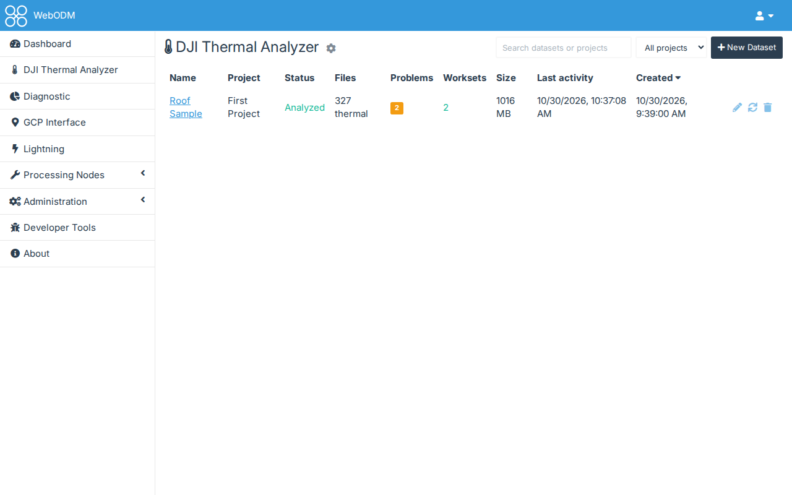
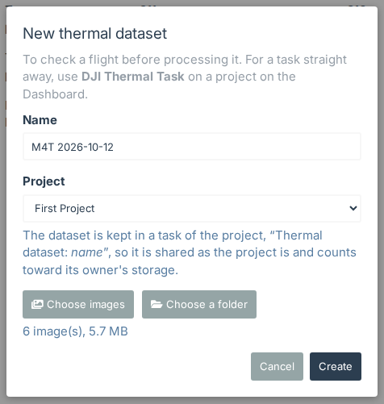
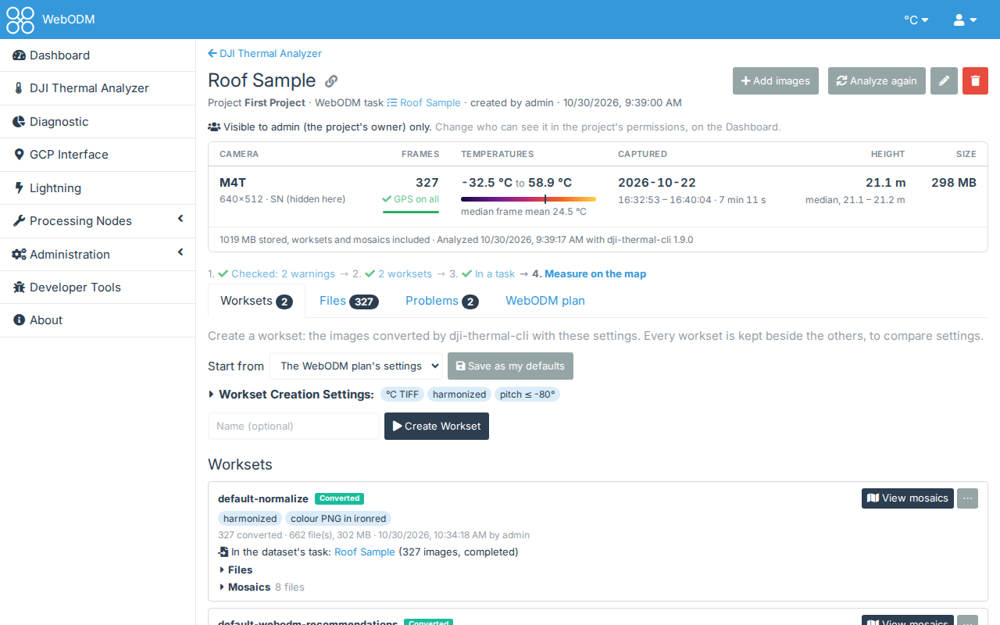
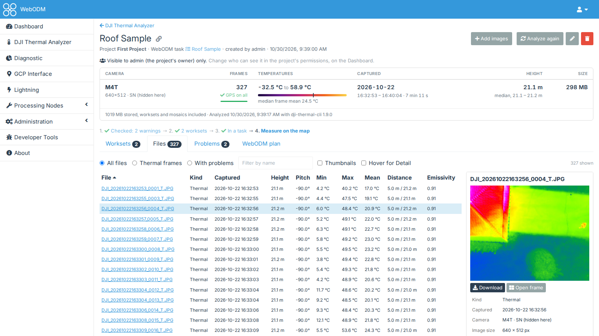
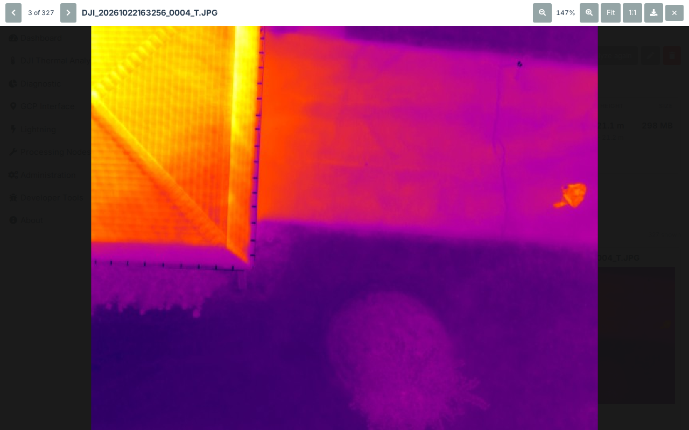
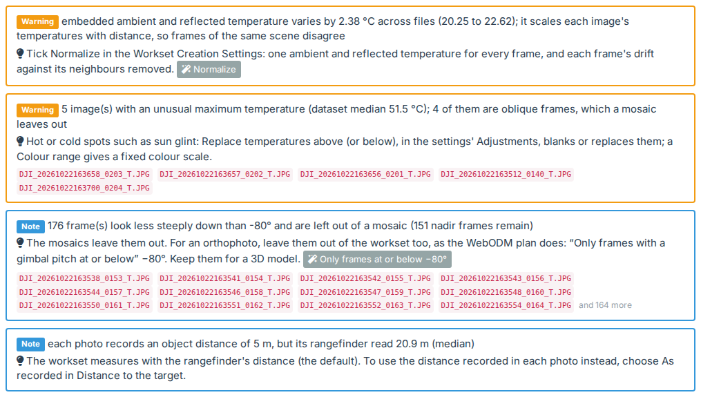
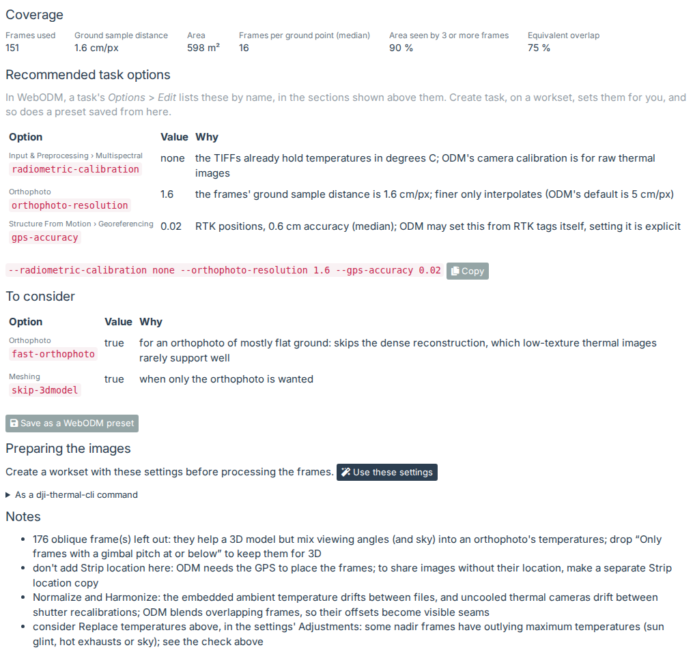
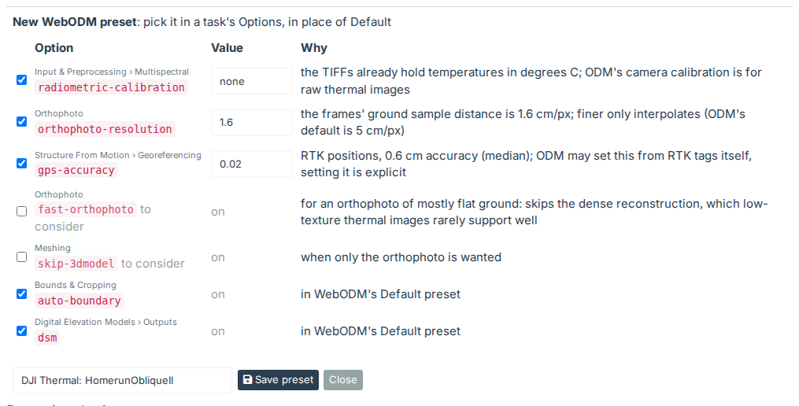

# Checking a flight in the DJI Thermal Analyzer

The DJI Thermal Analyzer looks at a flight's photos before you process them. It tells you what each photo is, what
problems it found, and which WebODM settings to use.

## 1. Make a dataset

Open **DJI Thermal Analyzer** in WebODM's menu. It lists the thermal datasets of every project you can view.

Press **New Dataset**. Give it a name, choose the project, and choose the flight's photos or their folder (you can
also drop them on the page).

Only JPEGs are uploaded. Visible photos are listed but not analyzed. Once uploaded, the photos are analyzed in
WebODM's background worker; the page shows its progress and a **Cancel** button.

The dataset is kept in a task of the project called "Thermal dataset: *name*" (a dataset made for a
[DJI Thermal Task](quickstart-thermal-task.md#5-look-at-the-photos-in-the-dji-thermal-analyzer)'s task is kept in
that task). So it's shared as the project is, and its photos count toward the project owner's storage.

## 2. Read the summary

The dataset's page opens with a summary: a row per camera with its frames, how many have GPS, the temperatures, when
they were taken, the height and the size. Under the name, a dataset kept in a WebODM task with images (one made with
DJI Thermal Task, or sent a workset) names that task, with a link to it on the dashboard.

Each figure is a link. Click the temperatures to see the hottest frames first, or the GPS count to see only the frames
without GPS.

Under the summary are the steps from photos to a temperature map. Each shows a ✓ when it's done, or links to where
you do it:

1. check the problems,
2. create a workset,
3. create a task from it,
4. measure on the map.

## 3. Look at the files

The **Files** tab lists every file with its capture time, height, gimbal pitch, temperatures, distance and
emissivity. You can filter it, sort it by any column and show thumbnails.

Click a file to open its detail pane beside the table. It shows the picture (a thermal frame drawn from its
temperatures), everything the analysis read from the file, and the problems that name it. Click the picture to see it full size:

In the viewer, zoom with the buttons, the mouse wheel or a double click, and drag to move around. **Fit** and **1:1**
reset the zoom. The arrows (or ← and →) go to the previous and next files; × or Esc closes it.

To select several files, Ctrl/Cmd-click or Shift-click them; the pane can then download them as a zip.

Once a workset has converted the photos, a thermal frame's name, and **Open frame** in its detail pane, open it on
the frame page of the newest one: see [One frame at a time](quickstart-worksets.md#one-frame-at-a-time).

## 4. Check the problems

The **Problems** tab lists what the analysis found: errors, warnings and notes. Each one says how to address it in
the workset's settings, and names the files concerned.

Some problems are fixed by a single setting, such as **Normalize** or leaving out oblique frames. Those have a button
that sets it in the workset settings for you.

## 5. Read the WebODM plan

The **WebODM plan** tab shows how well the frames cover the ground and which WebODM task options to use, with the
reason for each. Above each option's name is the section it's in, in WebODM's task options (a task's **Options** >
**Edit**), where options are listed by the same names.

**Save as a WebODM preset** saves the options as a preset of yours, to pick in a new task's **Options** in place
of Default. Tick the ones you want (the recommended ones are ticked, and so are the options of WebODM's own Default
preset, so nothing it sets is lost), name it, and **Save preset**. If you already have a preset with that name,
you're asked before it's replaced.

**Use these settings** fills in the workset settings the plan recommends. That's the next step:
[Worksets, mosaics and a task](quickstart-worksets.md).

## Also on the dataset's page

- **Add images** adds photos to the dataset; run **Analyze again** afterwards.
- The pencil renames the dataset and the bin deletes it. The link icon beside its name copies a link to the page.
- The gear beside the DJI Thermal Analyzer's heading sets your preferences: the temperature unit and the palette
  (see [Palettes and units](palettes.md)).
