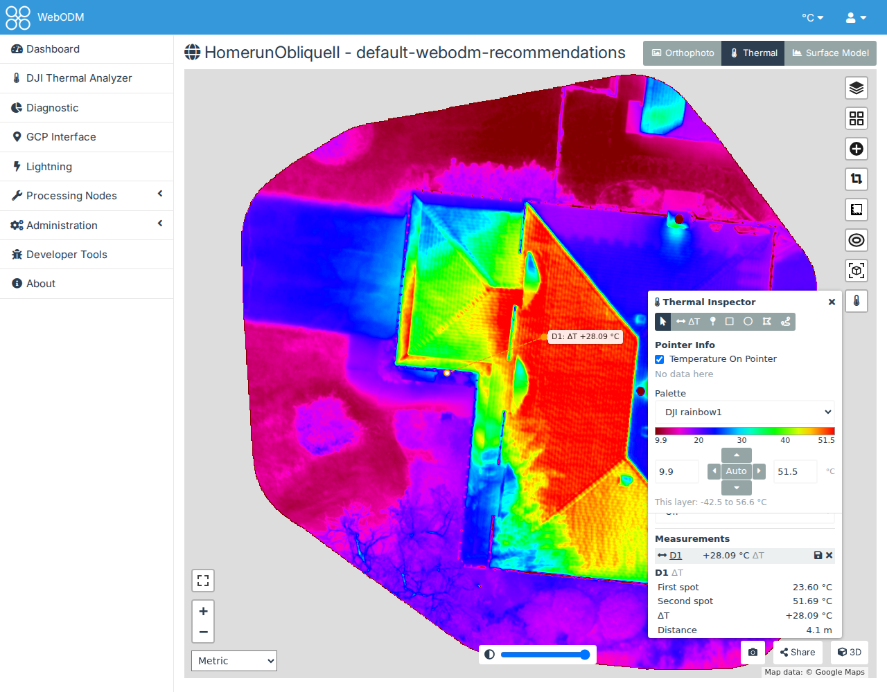

# Measuring on the map

The Thermal Inspector reads temperatures from a processed thermal task, on WebODM's 2D map. It works on any task
whose orthophoto holds temperatures: one made with [DJI Thermal Task](quickstart-thermal-task.md), or from a
[workset](quickstart-worksets.md). It can also lay the mosaics of the DJI Thermal Analyzer's worksets on the map, to
compare them with the project's own layers, show the frames that saw a point, keep measurements for everyone who
can view the project, and correct the temperatures for another emissivity.

## 1. Open it

Open the task's map from the dashboard (**View Map**), and press the thermometer button on the map's right. The
button is only on maps with temperatures: a thermal orthophoto, or a workset mosaic laid on the map by the Analyzer's
**Open on WebODM's map**. A map of RGB orthophotos only has none.

## 2. Read temperatures

The top of the panel (the buttons, Pointer Info, Palette and the colour scale) stays in view while the sections
below it scroll. The panel's buttons (icons, but ΔT: hover over one for its name and what it does) choose what a click
on the map does:

- **Hover**: the temperature under the cursor, in the panel under **Pointer Info**, and in a small label
  beside the pointer, a plain arrow rather than the hand. Clear **Temperature On Pointer** to hide the label: that choice is kept with your preferences,
  and applies to the Analyzer's mosaic viewer and frame page too (where the label is off until you tick it).
- **ΔT**: click a first spot, then a second (D1, D2…). The panel gives each spot's temperature, the temperature of
  its own pixel, and **ΔT**, the second's minus the first's: click the cold spot first and a warmer one second, and
  ΔT is above zero. The map shows a thin line between them, labelled with the ΔT at the second spot. With Manual
  Corrections on (section 8), both spots are corrected. Save it, rename it and delete it like a region.
- **Pin**: a click pins the point with its temperature (P1, P2…). The pins are listed in the panel; click one to go
  to it.
- **Rectangle**, **circle** and **polygon**: draw a region (R1, R2…). For a rectangle or circle, press and drag. For
  a polygon, click its corners, then double-click or press Enter to finish (Backspace removes the last corner, Esc
  cancels).
- **Line**: click the line's points, then double-click or press Enter to finish (L1, L2…).

For each region, the panel shows the minimum, maximum, mean, median, standard deviation, 2nd and 98th percentiles,
the number of pixels, the area and a histogram. The hottest and coldest pixels are marked on the map. It also shows:

- **Surroundings**: the mean temperature of a ring around the region, from its outline out to its size (between 1
  and 3 m).
- **ΔT**: the region's mean minus its surroundings'. A hot spot on a roof has a ΔT well above zero.
- **In the isotherm**: with an isotherm on (section 3), the share of the region's pixels within its limits. Change
  the limits and the region shown is measured again.

A line is measured along a strip 0.25 m either side of it, with its surroundings in a band 1 m wide beside it. In
place of the histogram it has its **profile**: the temperatures every pixel along it. Hover the profile to see each
point's distance and temperature, marked on the map; click it to open the frames that saw that point (section 6).

Pins, ΔTs, regions and lines are listed together under **Measurements**, in the order you made them, each with its
tool's icon. Click a row to see its figures under the list, or its name to go to it on the map. The buttons under
the list act on all of them: **Hide** and **Show**, **CSV** (one row each, with a **shape** column: a pin's position
and temperature, a region's or line's statistics, a ΔT's spots), and **Remove all**. A line's profile has its own
**Profile CSV** (distance, position and temperature of each point, and on a workset mosaic its frame). Your browser
keeps them for the next time you open the same task; to share one, save it (section 7).

## 3. Colours, legend and isotherms

- **Palette**: the thermal layer's colours, from the same list as the DJI Thermal Analyzer's. It's your palette
  everywhere: choosing one here also sets it in the Analyzer.
- **The colour scale**, under Palette: the palette over the range the layer is drawn with, with that range in two
  boxes in your unit. Type a new minimum or maximum, or use the cross of buttons between them: **◀** and **▶**
  narrow or widen the range by a tenth of it, about its middle; **▲** and **▼** raise or lower it by a tenth of its
  width, keeping the width, but never past the layer's hottest or coldest temperature; **Auto**, in the middle, sets
  the layer's 2nd to 98th percentile. "This
  layer" gives its own coldest and hottest temperatures. The range is the same one WebODM's layer panel sets: a
  range set there shows here, and the map draws the one set here. WebODM's panel only shows its new value when the
  page is next loaded.
- **Emissivity** and **Reflected**, under the colour scale: what the layer was measured with, greyed out until you
  tick **Manual Corrections** to correct for others (section 8).
- **Image**: how the layer is drawn, as in the Analyzer's mosaic viewer. **Brightness** and **Contrast** move and
  narrow the range from Auto's; **Gamma** above 1 brightens the cooler part of the range; **Banded** draws the
  colours in flat bands of one temperature width each, with the colour bar in the same bands, so a colour reads as a
  span of temperatures (the field beside it holds the width in your unit: Auto's at first, a round one giving 10 to 20
  bands that follows the range, until you type another or step it with its arrows; empty it for Auto's again;
  with Manual Corrections the bands are of corrected temperatures); **Sharpening** brings out edges. **Reset** goes back to
  Auto's range with no adjustments. The temperatures don't change, only the colours. The map follows each slider as it
  moves: your browser colours the layer from its temperatures, so nothing waits on the server. The frames window
  (section 6) is drawn again once you let go.
- **The legend on the map**: a colour bar with the palette's range, at the map's top left (hidden or shown in the DJI
  Thermal Analyzer's Preferences, under Thermal Inspector). Its two ends say the range's
  lowest and highest temperatures, with round values between them. If the image itself goes colder or hotter than
  that range (when it was narrowed in WebODM's layer panel), a line under the bar says how far: "Image: -42.5–56.6
  °C". Those parts take the colours of the bar's ends.
- **Isotherm**: paints the temperatures above, below or between limits you type, in a colour you choose. The
  legend marks the part painted. **Off** removes it.

With several thermal layers on the map, the scale and the Image section are those of the topmost one (the panel
says which), and each layer keeps its own. Nothing is remembered: each visit starts from the layer's own range,
with no adjustments.

The panel and the legend can be moved out of the way: drag the panel by its heading (the frames window comes along,
beside it), or the legend by any part. Both stay inside the map. Closing the panel or reloading the page puts
them back where they started. The frames window (section 6) can be dragged on its own too.

Temperatures are shown in your unit: the °C / °F menu at the top of the page, beside your user icon, linked to
WebODM's Metric/Imperial units. See [Palettes and units](palettes.md).

## 4. Mosaic Overlays on the map

**Mosaic Overlays**, at the bottom of the panel, holds the mosaics of every workset in the project's datasets; it is
there only when a workset has built mosaics. Its button says how many are shown ("Mosaic Overlays: 1 of 5 shown");
click it to open the list, and tick one to lay it on the map, above WebODM's layers. The list stays open while you
tick, and closes with the button again. Or open the map from the workset's **Open on WebODM's map**, which lays it
for you.

Once it's laid, it's listed below the button, list open or closed, with its controls (untick it there to lift it):

- Choose **Mosaic**, **Harmonized** or **Source frame**. It's drawn in your palette, over its own 2nd to 98th
  percentile.
- The slider sets its opacity.
- **Swipe** puts it on the right of WebODM's divider, with WebODM's layers on the left: drag the divider to compare
  it with a task's orthophoto or surface model. Choose that layer in WebODM's layer panel.
- The magnifier zooms to it.

Hover, pins, regions, the isotherm and the legend read the topmost thermal layer, the mosaic or a task's thermal
orthophoto.

The mosaics are the plugin's layers, not entries of WebODM's layer panel, and you lay them again each time you open
the map. WebODM shows a project's map only once one of its tasks has finished with an orthophoto or an elevation
model; until then, look at the mosaics in the Analyzer's [mosaic viewer](quickstart-worksets.md#3-the-mosaics).

## 5. Ortho Overlays on the map

On a task's map, **Ortho Overlays**, under Mosaic Overlays at the bottom of the panel, holds the orthophotos of the
project's other finished tasks: thermal ones (a thermometer beside the name) and RGB ones (a picture). It works as
Mosaic Overlays does: its button says how many are shown, opens the list, and each one you tick is laid on the map
above WebODM's layers and listed below the button with its opacity, **Swipe** and the magnifier.

- A **thermal** orthophoto is read as its own task's: hover, pins, regions, ΔT, the isotherm, the colour scale and the
  Image section read and draw it, in your palette. A measurement made on it is saved on that task.
- An **RGB** orthophoto is a picture, drawn as WebODM draws it, for context.
- To compare two flights, lay one and **Swipe** it: the readings follow WebODM's divider, so the cursor reads the
  overlay on its right and your task's orthophoto on its left. A ΔT is read from the layer under the middle of its two
  points.
- Pins, regions, lines and ΔTs, saved ones too, are drawn only where the layer they were read on shows: one read on
  your task's orthophoto ends at the divider. Drag the divider to see more of it. The same goes for a swiped workset
  mosaic.

On a project's map, WebODM already shows every task, in its own layer panel, so the list is empty there. If your task
has no thermal orthophoto but another in the project does, the Inspector's button shows so you can lay it.

## 6. The frames that saw a point

On a workset mosaic, or on the orthophoto of a task processed from a workset whose mosaics are built, a click in
**Hover** opens the frames that saw that point, beside the panel. Dropping a pin, or clicking a pin's name in the
panel, opens them too.

- The frame is drawn in the layer's palette and range, with a circle on the point; its outline is dashed on the map.
- The arrows step through every frame that saw the point. On a mosaic, the frame its pixel came from is first. On an
  orthophoto, ODM blended the frames, so they start with the one that saw the point closest to straight down.
- On an orthophoto the frames are placed with the workset's camera models, from their GPS and gimbal, not the cameras
  ODM refined: the point can be a little off.
- **Open this frame** opens the frame on its own page in the Analyzer, in a new tab, to measure it in its pixels or
  measure it again with other values: see [One frame at a time](quickstart-worksets.md#one-frame-at-a-time).
- Drag it by its heading to move it on its own: it stays where you drop it, even as the panel moves, until it's
  closed. Opened again, it's beside the panel.
- The cross closes the window; closing the Inspector closes it too.

On other layers a click in Hover is WebODM's own: its popup with the task's downloads.

## 7. Saving measurements

If you can change the project, each pin, region and line in the panel has a save button (the floppy disk). It opens
a small form: give the measurement a name (it starts as P1, R1 or L1) and, if you like, a comment, then **Save**.

The measurement is measured again on the server as it's saved, with the isotherm's limits and the correction
(section 8) that are on, and kept with what it measures: the task, or the workset of a mosaic laid on the map. It
leaves your **Measurements** and appears under **Saved measurements**:

- Everyone who can view the project sees the saved measurements of the layers on the map, dashed in green with their
  names. Click one to see its values as they were saved, its comment, who saved it and when, and the correction it
  was measured with; its name also zooms to it.
- If you can change the project, the pencil renames it or changes its comment, and the cross deletes it for
  everyone.
- **CSV** and **GeoJSON** download the list: a row or feature per measurement, with its values in your unit. A saved
  line has its own **Profile CSV**.

Saved measurements go with their task or workset: deleting either deletes them.

## 8. Correcting for another emissivity

The temperatures were measured with the emissivity and reflected temperature the camera recorded, or those set in
DJI Thermal Task or the workset (see [Measurement settings](measurement.md)). To see what a surface would measure with
others, use **Emissivity** and **Reflected**, under the colour scale's temperatures. They always show, greyed out
with what the topmost layer was measured with until you tick **Manual Corrections** under them; then they take any
emissivity from 0.1 to 1 and any reflected temperature from −100 to 1000 °C. Change them, and:

- the readout, pins, regions and lines show corrected temperatures (the regions are measured again);
- the legend's marks are corrected temperatures, and the isotherm's limits are too;
- the colour scale keeps the temperatures it shows (say 20 to 40 °C), so the map's colours change with the
  correction. **Auto** stretches the scale over the corrected layer again, which looks much like it did before: a
  correction moves every temperature the same way, so a fixed scale is what shows the difference.

The correction is approximate: a broadband model, with the air's transmission taken as 1, as at drone distances.
It's for comparing surfaces, not for calibrated values; for exact values, make a workset with the measurement
settings you want. A layer that doesn't record how it was measured (an orthophoto that wasn't made from the plugin's
TIFFs) isn't corrected, and the panel says so. Each visit starts with the box unticked. Untick it to go back: the
values you typed are forgotten and the fields grey out with the layer's own again.
