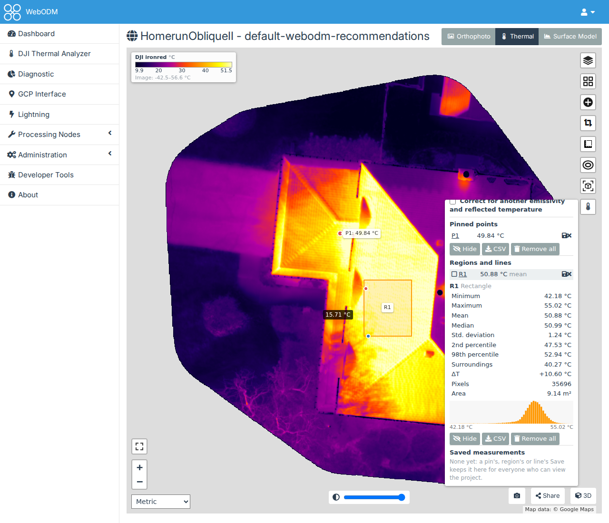
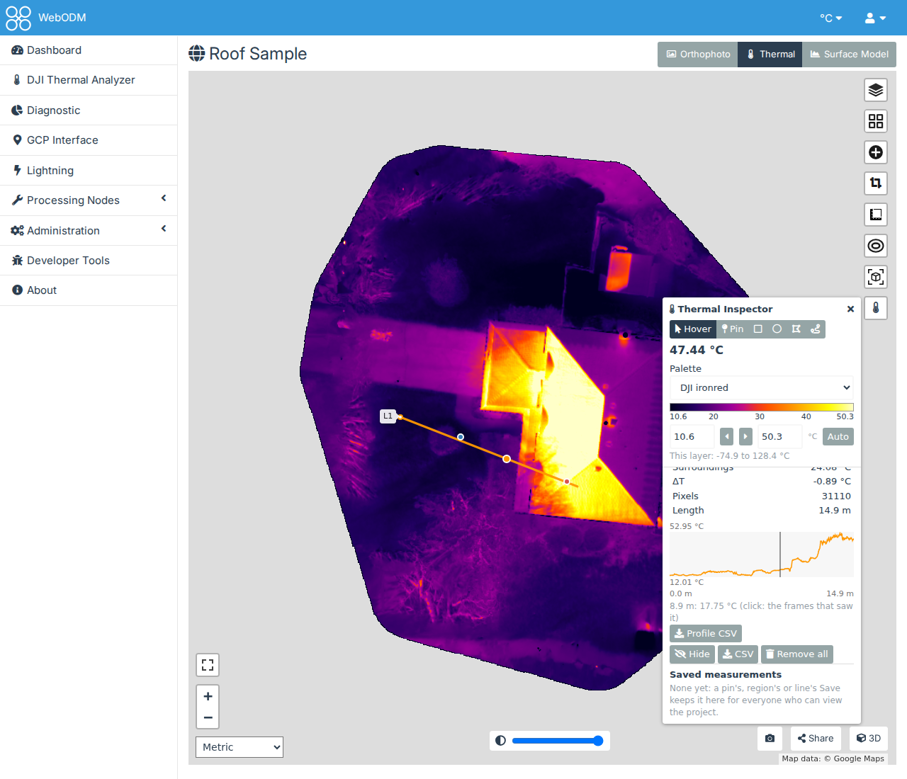
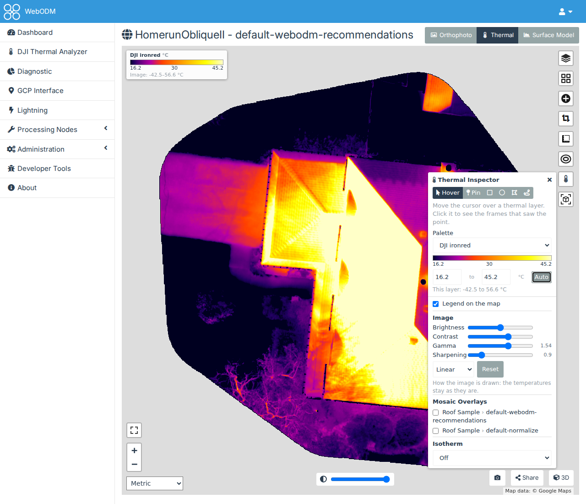
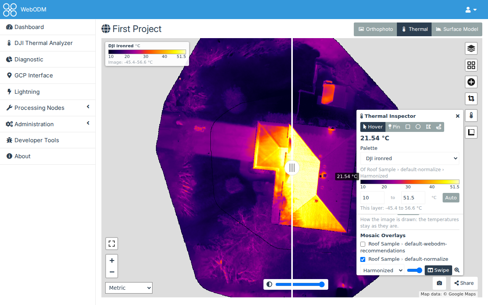
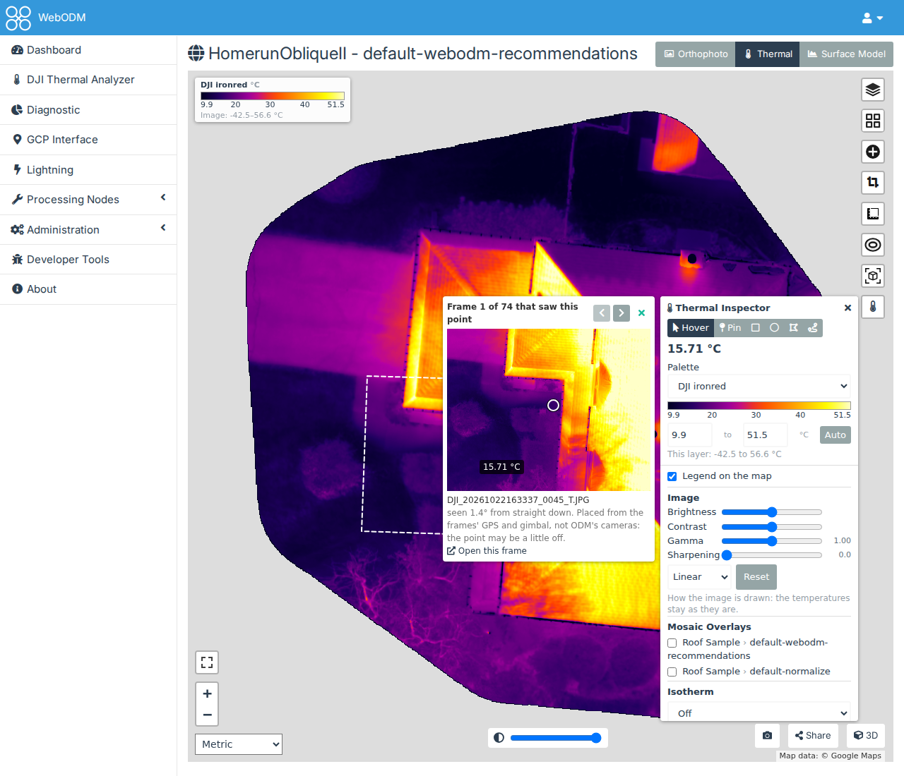
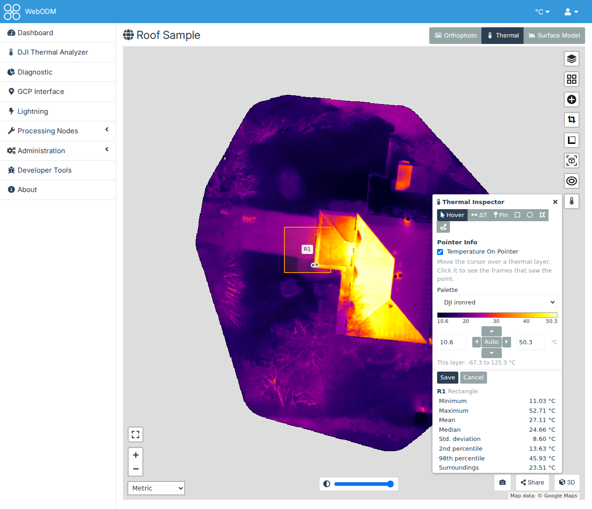

# Measuring on the map

The Thermal Inspector reads temperatures from a processed thermal task, on WebODM's 2D map. It works on any task
whose orthophoto holds temperatures: one made with [DJI Thermal Task](quickstart-thermal-task.md), or from a
[workset](quickstart-worksets.md). It can also lay the mosaics of the DJI Thermal Analyzer's worksets on the map, to
compare them with the project's own layers, show the frames that saw a point, keep measurements for everyone who
can view the project, and correct the temperatures for another emissivity.

## 1. Open it

Open the task's map from the dashboard (**View Map**), and press the thermometer button on the map's right. The
button is also on any map of a project with workset mosaics, even one with no thermal orthophoto.

## 2. Read temperatures

The top of the panel (the buttons, the temperature, Palette and the colour scale) stays in view while the sections
below it scroll. The panel's buttons choose what a click on the map does:

- **Hover**: the temperature under the cursor, beside it and in the panel.
- **Pin**: a click pins the point with its temperature (P1, P2…). The pins are listed in the panel; click one to go
  to it.
- **Rectangle**, **circle** and **polygon**: draw a region (R1, R2…). For a rectangle or circle, press and drag. For
  a polygon, click its corners, then double-click or press Enter to finish (Backspace removes the last corner, Esc
  cancels).
- **Line**: click the line's points, then double-click or press Enter to finish (L1, L2…).

For each region, the panel shows the minimum, maximum, mean, median, standard deviation, 2nd and 98th percentiles,
the number of pixels, the area and a histogram. The hottest and coldest pixels are marked on the map. It also shows:

- **Surroundings**: the mean temperature of a ring around the region, from its outline out to its size (between 1
  and 3 m).
- **ΔT**: the region's mean minus its surroundings'. A hot spot on a roof has a ΔT well above zero.
- **In the isotherm**: with an isotherm on (section 3), the share of the region's pixels within its limits. Change
  the limits and the region shown is measured again.

A line is measured along a strip 0.25 m either side of it, with its surroundings in a band 1 m wide beside it. In
place of the histogram it has its **profile**: the temperatures every pixel along it. Hover the profile to see each
point's distance and temperature, marked on the map; click it to open the frames that saw that point (section 5).

Pins, regions and lines can be hidden, removed, and downloaded as CSV; a line's profile has its own **Profile CSV**
(distance, position and temperature of each point, and on a workset mosaic its frame). Your browser keeps them for
the next time you open the same task; to share one, save it (section 6).

## 3. Colours, legend and isotherms

- **Palette**: the thermal layer's colours, from the same list as the DJI Thermal Analyzer's. It's your palette
  everywhere: choosing one here also sets it in the Analyzer.
- **The colour scale**, under Palette: the palette over the range the layer is drawn with, with that range in two
  boxes in your unit. Type a new minimum or maximum, or click **Auto** for the layer's 2nd to 98th percentile. "This
  layer" gives its own coldest and hottest temperatures. The range is the same one WebODM's layer panel sets: a
  range set there shows here, and the map draws the one set here. WebODM's panel only shows its new value when the
  page is next loaded.
- **Image**: how the layer is drawn, as in the Analyzer's mosaic viewer. **Brightness** and **Contrast** move and
  narrow the range from Auto's; **Gamma** above 1 brightens the cooler part of the range; **Equalized** spreads the
  colours over the temperatures the whole layer has most of; **Sharpening** brings out edges. **Reset** goes back to
  Auto's range with no adjustments. The temperatures don't change, only the colours. The map follows each slider as it
  moves: your browser colours the layer from its temperatures, so nothing waits on the server. The frames window
  (section 5) is drawn again once you let go.
- **Legend on the map**: a colour bar with the palette's range, at the map's top left. Its two ends say the range's
  lowest and highest temperatures, with round values between them. If the image itself goes colder or hotter than
  that range (when it was narrowed in WebODM's layer panel), a line under the bar says how far: "Image: -42.5–56.6
  °C". Those parts take the colours of the bar's ends.
- **Isotherm**: paints the temperatures above, below or between limits you type, in a colour you choose. The
  legend marks the part painted. **Off** removes it.

With several thermal layers on the map, the scale and the Image section are those of the topmost one (the panel
says which), and each layer keeps its own. Nothing is remembered: each visit starts from the layer's own range,
with no adjustments.

The panel and the legend can be moved out of the way: drag the panel by its heading (the frames window comes along,
beside it), or the legend by any part. Both stay inside the map. Closing the panel, hiding the legend or reloading
the page puts them back where they started.

Temperatures are shown in WebODM's units: °F when its map is set to Imperial, °C otherwise. See
[Palettes and units](palettes.md).

## 4. Mosaic Overlays on the map

**Mosaic Overlays** in the panel lists the mosaics of every workset in the project's datasets; the section is there
only when a workset has built mosaics. Tick one to lay it
on the map, above WebODM's layers, or open the map from the workset's **Open on WebODM's map**, which lays it for
you.

Once it's laid:

- Choose **Mosaic**, **Harmonized** or **Source frame**. It's drawn in your palette, over its own 2nd to 98th
  percentile.
- The slider sets its opacity.
- **Swipe** puts it on the right of WebODM's divider, with WebODM's layers on the left: drag the divider to compare
  it with a task's orthophoto or surface model. Choose that layer in WebODM's layer panel.
- The magnifier zooms to it.

Hover, pins, regions, the isotherm and the legend read the topmost thermal layer, the mosaic or a task's thermal
orthophoto.

The mosaics are the plugin's layers, not entries of WebODM's layer panel, and you lay them again each time you open
the map. WebODM shows a project's map only once one of its tasks has finished with an orthophoto or an elevation
model; until then, look at the mosaics in the Analyzer's [mosaic viewer](quickstart-worksets.md#3-the-mosaics).

## 5. The frames that saw a point

On a workset mosaic, or on the orthophoto of a task processed from a workset whose mosaics are built, a click in
**Hover** opens the frames that saw that point, beside the panel. Dropping a pin, or clicking a pin's name in the
panel, opens them too.

- The frame is drawn in the layer's palette and range, with a circle on the point; its outline is dashed on the map.
- The arrows step through every frame that saw the point. On a mosaic, the frame its pixel came from is first. On an
  orthophoto, ODM blended the frames, so they start with the one that saw the point closest to straight down.
- On an orthophoto the frames are placed with the workset's camera models, from their GPS and gimbal, not the cameras
  ODM refined: the point can be a little off.
- The cross closes the window; closing the Inspector closes it too.

On other layers a click in Hover is WebODM's own: its popup with the task's downloads.

## 6. Saving measurements

If you can change the project, each pin, region and line in the panel has a save button (the floppy disk). It opens
a small form: give the measurement a name (it starts as P1, R1 or L1) and, if you like, a comment, then **Save**.

The measurement is measured again on the server as it's saved, with the isotherm's limits and the correction
(section 7) that are on, and kept with what it measures: the task, or the workset of a mosaic laid on the map. It
leaves your own lists and appears under **Saved measurements**:

- Everyone who can view the project sees the saved measurements of the layers on the map, dashed in green with their
  names. Click one to see its values as they were saved, its comment, who saved it and when, and the correction it
  was measured with; its name also zooms to it.
- If you can change the project, the pencil renames it or changes its comment, and the cross deletes it for
  everyone.
- **CSV** and **GeoJSON** download the list: a row or feature per measurement, with its values in your unit. A saved
  line has its own **Profile CSV**.

Saved measurements go with their task or workset: deleting either deletes them.

## 7. Correcting for another emissivity

The temperatures were measured with the emissivity and reflected temperature the camera recorded, or those set in
DJI Thermal Task or the workset (see [Measurement settings](measurement.md)). To see what a surface would measure with
others, tick the box beside **Manual Corrections**. The values start from what the topmost
layer was measured with, and the panel lists what each layer on the map was measured with. Change them, and:

- the readout, pins, regions and lines show corrected temperatures (the regions are measured again);
- the legend's marks are corrected temperatures, and the isotherm's limits are too;
- the map's colours stay as they are.

The correction is approximate: a broadband model, with the air's transmission taken as 1, as at drone distances.
It's for comparing surfaces, not for calibrated values; for exact values, make a workset with the measurement
settings you want. A layer that doesn't record how it was measured (an orthophoto that wasn't made from the plugin's
TIFFs) isn't corrected, and the panel says so. Your browser keeps the correction for the same tasks. Untick the box
to go back: the values you typed are forgotten and the fields close, so ticking it again starts from the layer's own.
