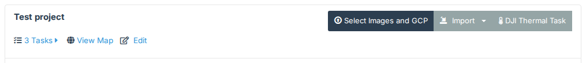
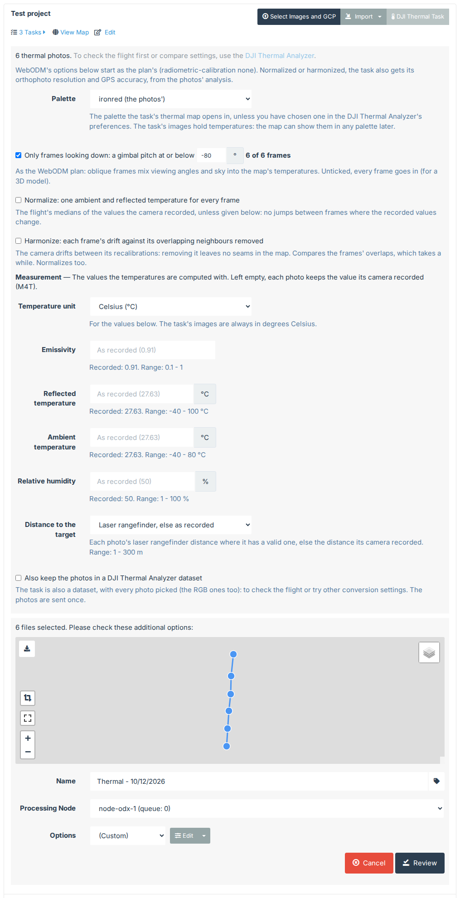

# A thermal map with DJI Thermal Task

From a DJI flight's photos to a WebODM orthophoto of temperatures, in one go. To look at the flight before
processing it, or to compare settings, see [Checking a flight in the DJI Thermal Analyzer](quickstart-analyzer.md)
instead.

You need the photos of a flight made with a [supported camera](index.md#cameras), and a WebODM project you can
change.

## 1. Choose the photos

On WebODM's dashboard, press **DJI Thermal Task** on your project, beside **Select Images and GCP**.

Pick the flight's photos. You can pick all of them: the plugin finds the thermal R-JPEGs by their content and leaves
out the visible (RGB) photos taken with them. You can add a GCP file too.

## 2. Check the measurement values

The panel shows how many thermal photos it found, then the **Palette**: the DJI palette the task's thermal map
opens in, starting on the one the photos were shot in. It doesn't change the task's images, which hold temperatures,
and your own palette, if you've chosen one in the DJI Thermal Analyzer's preferences, comes first; the map can show
any palette later.

**Only frames looking down**, ticked by default, keeps only the frames with a gimbal pitch at or below the limit
beside it, -80° as the WebODM plan has it, and says how many that is ("42 of 217 frames"): oblique frames mix viewing
angles and sky into the map's temperatures. Change the limit to keep more or fewer, or untick it to keep every
frame, for a 3D model.

Then two settings, off by default:

- **Normalize** measures every frame with one ambient and reflected temperature, the flight's medians of the values
  the camera recorded, so there are no jumps between frames where those values change.
- **Harmonize** also removes each frame's drift against the frames overlapping it, so the map has no seams. It takes
  longer, and ticks Normalize. [Measurement settings](measurement.md#normalize-and-harmonize) explains
  both.

Both need every photo before any is converted. With either ticked, the photos are uploaded to the task's
[DJI Thermal Analyzer](quickstart-analyzer.md) dataset first (**Also keep the photos**, below, is ticked for you),
WebODM's worker converts them in a workset of that dataset, and the task starts processing once they're converted.
The message under the project shows how far the conversion is, with a progress bar, then a green **Complete!** once
the task has started, and links to the dataset. The dataset is analyzed meanwhile, for the options (section 3).
You can close or refresh the page once the upload is done: the task's
panel (click its name in the project's task list) shows the same progress. Don't press WebODM's own **Start Processing**
meanwhile: it would process the photos unconverted. **Also build the workset's mosaics**, off
by default, builds the dataset's mosaics of the converted photos as well; you can build them later from the
workset's menu in the DJI Thermal Analyzer (**Build mosaics**).

Then come the values the temperatures are computed with.

Each field shows the value the camera recorded and the range it accepts. Leave a field empty to keep each photo's
own recorded value; this is usually right. Fill one in when you know better, for example the emissivity of the
material you're measuring. [Measurement settings](measurement.md) explains each one.

**Temperature unit** is the unit of the values you type. The task's images are always in degrees Celsius.

**Also keep the photos in a DJI Thermal Analyzer dataset**, under the values: tick it to look at the photos in the
[DJI Thermal Analyzer](quickstart-analyzer.md) too. The task is also a dataset, under its own name, with every
photo you picked (the RGB ones too). The photos are sent once, for both, and the dataset is
analyzed once the task is made; the message under the project links to it. Without it, the task keeps only the
converted images (see section 5).

## 3. Start processing

Below the measurement values is WebODM's usual task panel: the task's name, the processing node and the options.
The options start as the WebODM plan's: **(Custom)**, with `radiometric-calibration` none, as the images already hold
temperatures. Normalized or harmonized, a task whose options you leave so also gets the plan's orthophoto resolution
(the frames' ground sample distance) and GPS accuracy (from the RTK positions), from the dataset's analysis, before it
starts. Pick another preset to use your own. The thermal frames keep their size; they aren't resized. Press
**Review**, then **Start Processing**.

Each photo is converted into a temperature image as it uploads, a few at a time. If a photo can't be converted,
it's left out and the panel says why; the task processes the others.

## 4. Look at the result

When WebODM has finished, open the task's map. Its orthophoto holds temperatures, and the
[Thermal Inspector](quickstart-inspector.md) reads them.

## 5. Look at the photos in the DJI Thermal Analyzer

Unless you kept the photos in a dataset (section 2), the task keeps only the converted images. To check the photos (each frame's temperatures, camera
and position, and the problems found), or to try other conversion settings, give the task a dataset: in its
expanded panel on the dashboard, press **Create thermal dataset**. The task becomes a dataset too, under its own
name (no other task is added), and the dataset opens, empty: add the flight's photos with **Add images** (see
[Checking a flight in the DJI Thermal Analyzer](quickstart-analyzer.md)). From then on the task's panel has a **Thermal
dataset** button, back to it. Deleting the dataset leaves the task as it was, with its images and results,
and the Thermal Inspector's measurements saved on its map.

## Good to know

- A GCP file, `geo.txt` and `image_groups.txt` are uploaded with the photos. The image names in them are changed
  to the converted images' names (`DJI_0001_T.JPG` becomes `DJI_0001_T.tif`).
- The task's name comes from the first photo's date. WebODM's own upload looks the place up on OpenStreetMap; the
  DJI Thermal Task doesn't, because the plugin calls no outside service.
- [The converted images](converted-images.md) describes what each uploaded TIFF holds.
