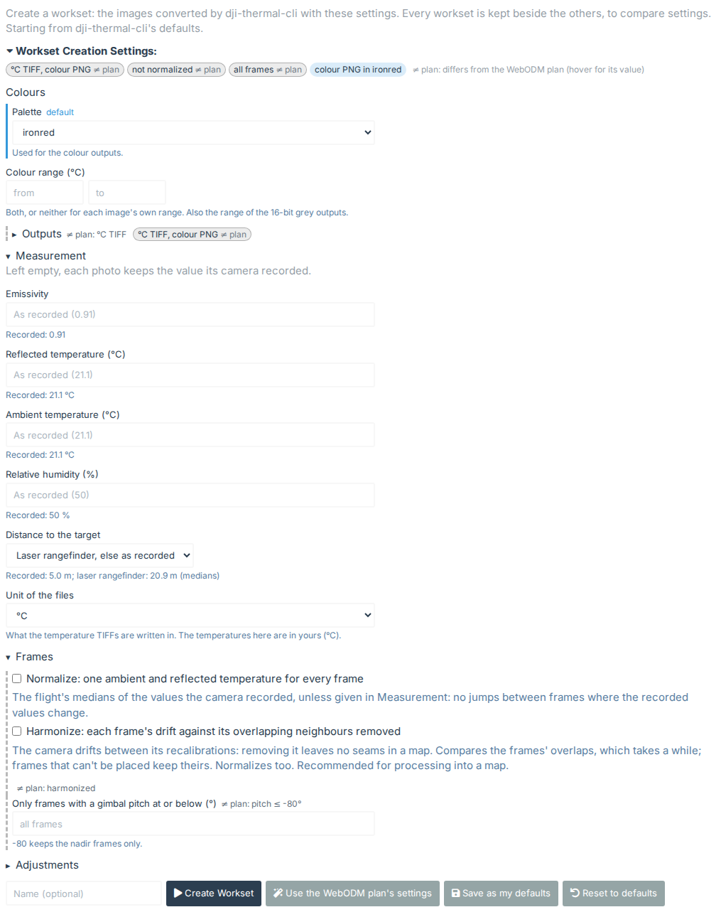
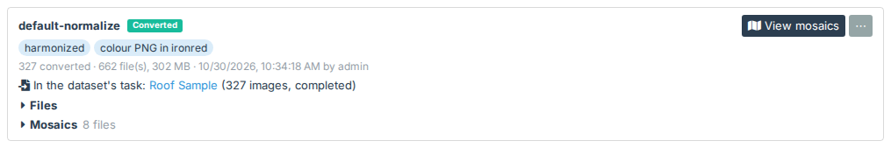
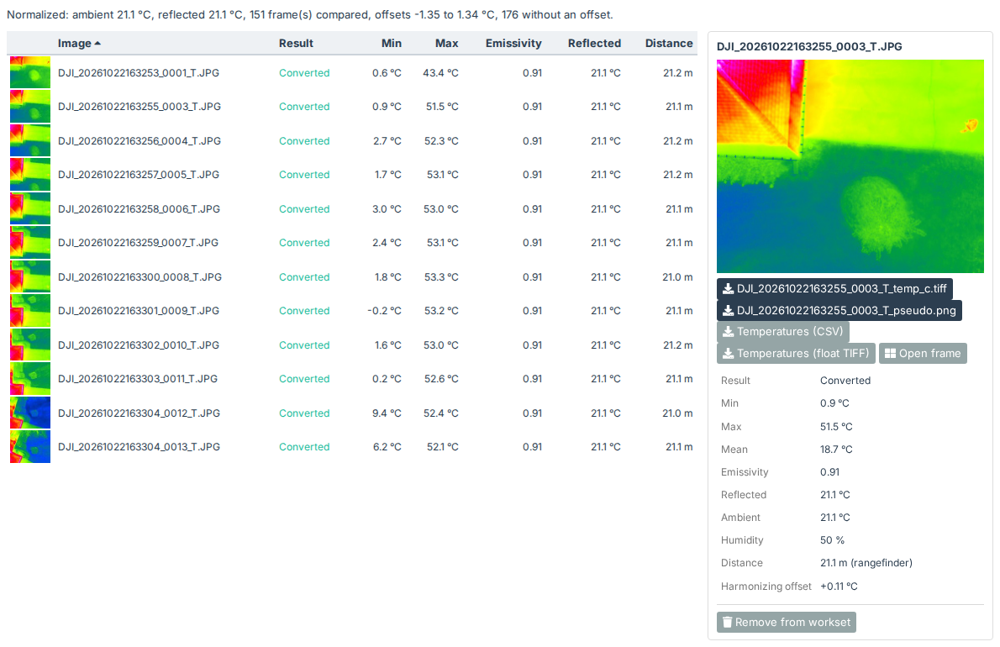
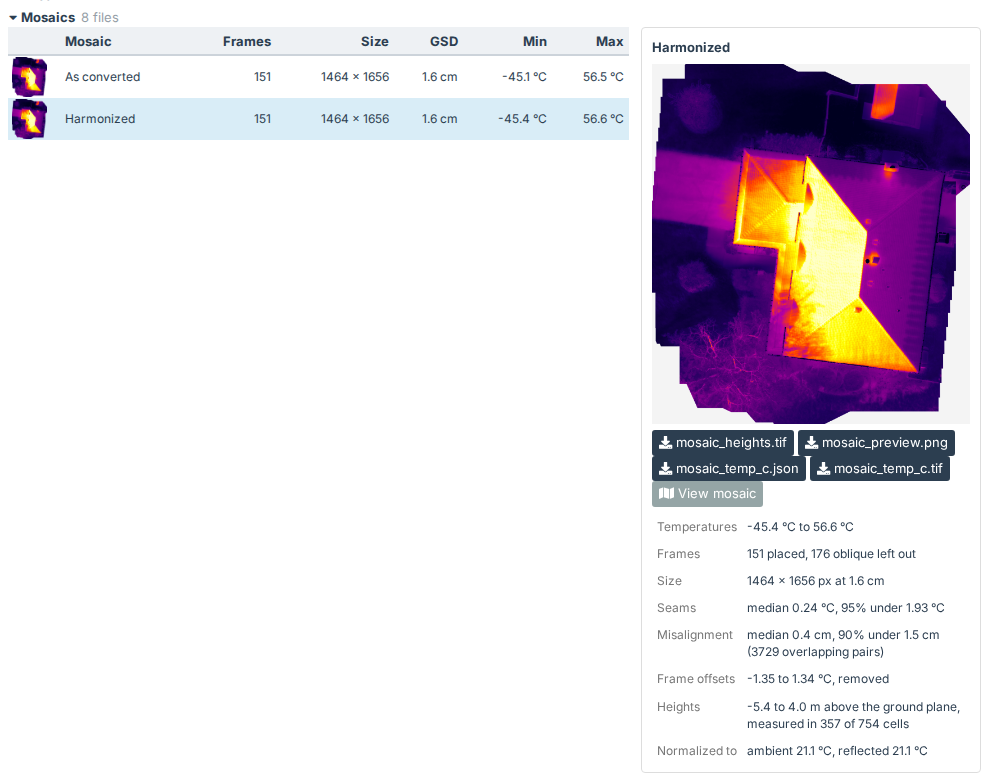
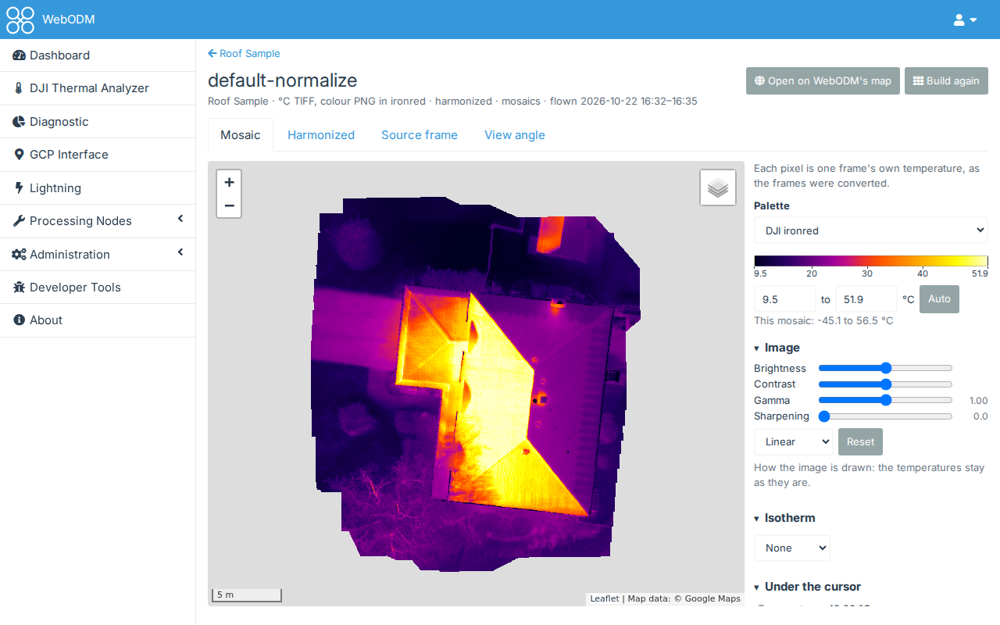
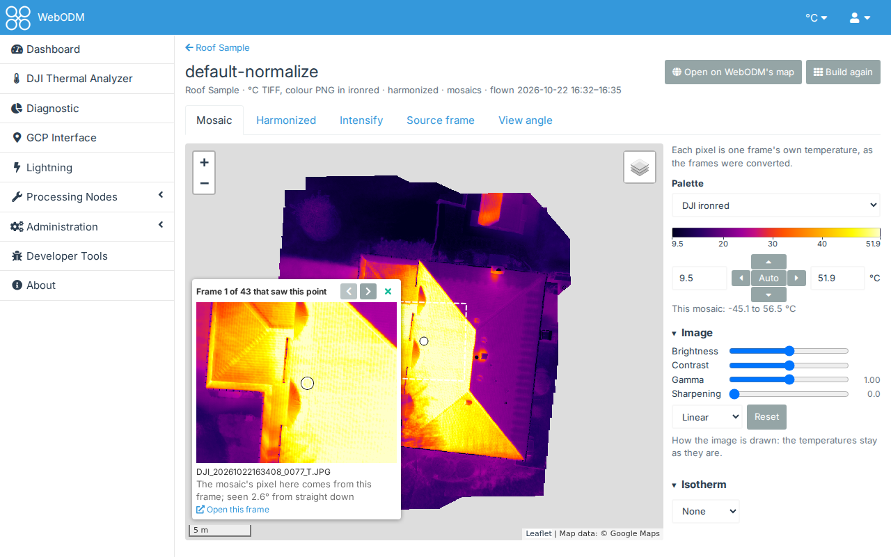
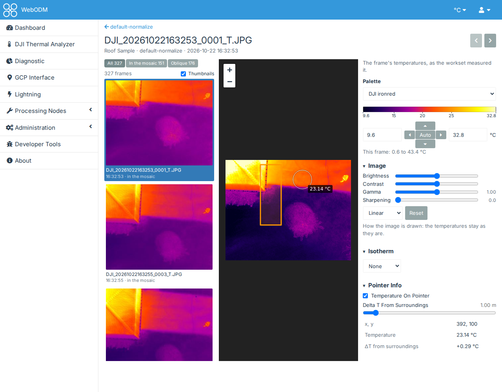
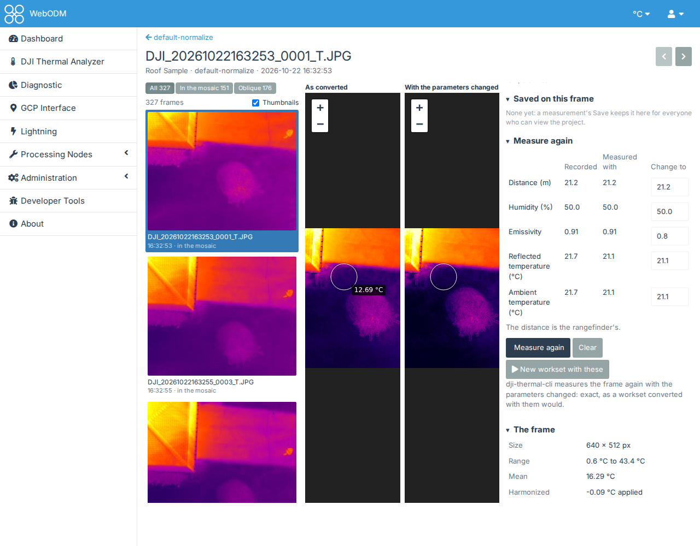
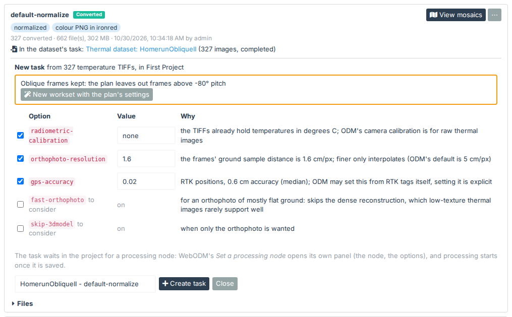

# Worksets, mosaics and a task

A **workset** is the dataset's photos converted with one set of settings. You can make several and compare them
side by side. Then you look at a workset's mosaics, and make a WebODM task from the one you like. This follows
[Checking a flight in the DJI Thermal Analyzer](quickstart-analyzer.md).

## 1. Choose the settings

On the dataset's page, the **Worksets** tab comes first. **Workset Creation Settings:** opens and closes the
settings. Its chips show what differs from dji-thermal-cli's defaults, even when it's closed.

The quickest start: **Use the WebODM plan's settings**, on the Worksets tab (or **Use these settings** on the WebODM
plan tab). It fills in what the plan recommends for processing in WebODM.

The settings are in sections:

- **Colours**: the palette and colour range of the colour pictures.
- **Outputs**: which files to write (temperature TIFFs in °C, °F or K, colour PNGs, 16-bit grey, DJI R-JPEGs and
  others), their compression, and whether to build mosaics.
- **Measurement**: the values the temperatures are computed with. Left empty, each photo keeps its recorded value;
  the recorded median shows under each field. See [Measurement settings](measurement.md).
- **Frames**: **Normalize** (one ambient and reflected temperature for every frame), **Harmonize** (also each
  frame's drift removed, so a map has no seams; see [Measurement settings](measurement.md)) and a gimbal pitch
  limit that keeps only the frames looking straight down.
- **Adjustments**: gimbal angle overrides, temperatures above or below a threshold replaced, and the location and
  identifiers stripped from the outputs.

A chip or field marked **≠ plan** differs from the WebODM plan's settings; hover over it to see the plan's value.
That isn't an error: the plan is for processing into a map, and other settings suit other uses.

**Save as my defaults** keeps your settings for new worksets; **Reset to defaults** goes back to dji-thermal-cli's.

Give the workset a name if you like, then press **Create Workset**. It's converted in WebODM's background worker,
with its progress and a **Cancel** button.

## 2. The workset

Each workset is listed with the settings it changed, how many images it converted, and its size.

- **Files** opens a table of each image: its thumbnail, result, minimum and maximum temperature, emissivity,
  reflected temperature and distance as the workset measured them, and why any image was skipped. Its headings stay
  in view as it scrolls; click one to sort by it, and again to reverse the order. The detail pane beside it shows the image under the mouse, or the one you click: the frame at its own
  size (click it for the picture viewer), all it was measured with, the workset's files for it, its temperatures as
  CSV or a float TIFF, and **Open frame**. Ctrl/Cmd-click or Shift-click selects several images, to download their
  files as one zip. **Remove from workset**, at the bottom of the pane, takes out an image that is more noise than
  use (or those selected), once you confirm: its files are deleted, with the measurements saved on it, and the
  workset's line counts it as removed. New tasks and mosaics are made without it; the tasks made before keep their
  images, and mosaics built with it say so, with **Build again**. It needs the right to change the project. The figures are measured once, after the workset converts; an older workset's are measured the
  first time its Files are opened, which takes a few seconds.

- **Mosaics**, below Files once the workset's mosaics are built, is a table like the Files': a row for the mosaic
  as converted and one for the harmonized, with its preview, the frames it was built from, its size, its ground sample
  distance and its lowest and highest temperature. The detail pane beside it shows the mosaic under the mouse, or the
  one you click: its preview (click it for the picture viewer), its files to download (a temperature TIFF with its
  JSON report, the preview and, when the frames were projected onto heights, those heights), what dji-thermal-cli
  reports about it (seams, misalignment, frame offsets, heights) and **View mosaic**, which opens the mosaic viewer on
  it. Ctrl/Cmd-click selects both, to download their files as one zip. It opens and closes as Files does, and
  **Download all**'s zip has the mosaics too.

- The **⋯** menu has **Download all** (a zip), **Copy settings to form**, **Build mosaics**, **Create task** (once
  the workset is in a task), **Use for parent task**, **Rename** and **Delete**.

## 3. The mosaics

With mosaics on (the default), dji-thermal-cli places the frames side by side from their positions and angles. That
gives a quick look at the whole flight without a WebODM task. Press **View mosaics**.

The tabs:

- **Mosaic**: the frames as converted.
- **Harmonized**: the frames made to agree on temperature. The camera drifts a little between its
  self-calibrations, so overlapping frames can read a degree or two apart; here each frame is shifted to match its
  neighbours.
- **Source frame**: which frame each pixel comes from.
- **View angle**: the angle each pixel was seen at.

The panel on the right sets the palette and the colour range (**Auto** uses the 2nd to 98th percentile), and under
**Image** how the image is drawn: **Brightness** and **Contrast** move and narrow the range, **Gamma** brightens the
cooler part of it (above 1) or the warmer part (below 1), **Sharpening** brings out edges, **Equalized** spreads the
colours over the temperatures the mosaic has most of, and **Reset** goes back to the Auto range with none of them.
They only change how the image is drawn, never the temperatures, and the map follows them as they move: your browser
colours the mosaic from its temperatures, so nothing waits on the server. An **Isotherm** (above, below or between
temperatures) keeps the palette for the pixels in it and turns the rest grey. It shows the
temperature, frame, frame pixel and view angle under the cursor, what dji-thermal-cli reports about the mosaic (seams,
misalignment, frame offsets), and the files to download.

Click the map to keep the values at that point (**Follow the cursor**, or Esc, lets go of it) and to see **every frame
that saw that point**, with the arrows to go through them:

### One frame at a time

**Open this frame**, under the frame in that window, opens it on the frame page in a new tab (a thermal frame's
name on the Files tab opens it too). The frames are listed on the left in the order they were taken; click one, or
step with ← and →. Once the mosaics are built, **All**, **In the mosaic** and **Oblique** choose which are listed.
The panel has the same palette, range, **Image** and **Isotherm** as the mosaic viewer, and the temperature under the
cursor.

**Measure** has the Thermal Inspector's tools, in the frame's pixels: **Pin**, **Line**, **Rectangle**, **Circle** and
**Polygon**. Click a row for its statistics (a line's profile, a region's histogram, the surroundings and ΔT). Those
who can change the project can **Save** one: it stays with the workset, under **Saved on this frame**, for everyone
who can view the project.

**Measure again** shows the frame's distance, humidity, emissivity, reflected and ambient temperature: as the camera
recorded them, as the frame was measured with them, and fields to change them. Change one and press **Measure
again** (or Enter): dji-thermal-cli measures the frame again, exactly as a workset with those settings would, and
shows it beside the first, with both temperatures and their difference under the cursor. Pins and regions are
measured with the new values too.

**New workset with these** opens the Worksets tab with the form filled in with this workset's settings and the
changed values, ready to convert the whole flight with them. **Download** saves the frame as shown (PNG) or its
temperatures (CSV, or a 32-bit TIFF without a location), as converted or with the values changed.

**Open on WebODM's map**, at the top (and in the workset's menu), opens WebODM's map of the project with this mosaic
laid on it, to compare it with the project's tasks: see [Measuring on the map](quickstart-inspector.md#4-mosaic-overlays-on-the-map).
It's there once WebODM has a map of the project, that is once one of its tasks has finished with an orthophoto or
an elevation model.

## 4. A WebODM task

**Create task** makes a WebODM task in the dataset's project from the workset's temperature TIFFs in °C, without
uploading them again. It's beside **View mosaics** on a workset that isn't in a task yet, and in its menu after that.

The panel:

- says what would stop the task (a workset still converting, its location stripped, or fewer than 2 °C TIFFs);
- warns where the workset's settings are off the WebODM plan, with **New workset with the plan's settings**;
- lists the plan's WebODM options, the recommended ones ticked, each with its value and reason.

The task is made **without a processing node**. It waits in the project with **Set a processing node**, which opens
WebODM's own panel. Processing starts once you save it there.

The workset then lists its tasks with their status. On the dashboard, the task's expanded panel has a **Thermal
dataset** button that brings you back to the dataset.

### Trying several worksets in one task

**Use for parent task**, in a workset's menu, sends its TIFFs to the dataset's own task instead of a new one. You
can then process one task again and again as you try worksets. The TIFFs replace the ones sent before, and what the
task processed from them is removed; the dialog says what it replaces. This is refused while the task is processing.

When the task has processed, measure on its map: [Measuring on the map](quickstart-inspector.md).
